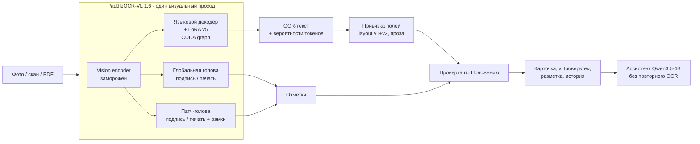
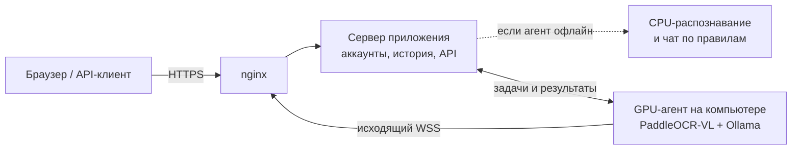

<div align="center">

# Онлайн-деканат

**Предварительная проверка студенческих документов одной локальной нейросетью**

Фото или скан справки → текст, поля, подпись и печать → проверка по Положению → ответы на вопросы в чате.
Без внешних API: распознавание, извлечение и ответы выполняются собственными моделями.

[](https://dekanat.karpovprod.ru)


</div>

---

## Содержание

- [Что это](#что-это)
- [Возможности](#возможности)
- [Как это работает](#как-это-работает)
- [Качество и скорость](#качество-и-скорость)
- [Быстрый старт](#быстрый-старт)
- [Структура репозитория](#структура-репозитория)
- [Модели](#модели)
- [Данные](#данные)
- [Документация](#документация)
- [Ограничения](#ограничения)
- [Лицензии](#лицензии)

## Что это

Студент загружает справку или заявление и сразу видит, всё ли в нём на месте. Сервис:

- читает документ и находит поля: ФИО, даты, номер, организацию и т. д.;
- определяет наличие подписи и печати и показывает, где они на странице;
- проверяет комплектность по Положению и называет недостающие пункты;
- отвечает на вопросы о документе в чате: «Сколько длилась практика?», «Кто подписал?», «Чего не хватает?».

Окончательное решение остаётся за сотрудником деканата. Сервис выполняет только предварительную проверку и не сообщает «документ принят».

Поддерживаются три типа документов (правила кейса — в [`configs/participant_v1.json`](configs/participant_v1.json)):

| Тип | Ключ | Обязательные сведения |
| --- | --- | --- |
| Справка об обучении | `study_certificate` | ФИО, вуз, направление, форма обучения, начало и окончание обучения, номер, дата выдачи, подпись, печать |
| Заявление на академический отпуск | `academic_leave_application` | ФИО, группа, курс, причина, начало и окончание отпуска, дата заявления, подпись студента |
| Справка о практике | `internship_certificate` | ФИО, организация, начало и окончание практики, руководитель, оценка, номер, дата выдачи, подпись, печать |

Форматы: PNG, JPG и одностраничный PDF до 10 МБ.

## Возможности

| | |
| --- | --- |
| **Одна модель на всё** | PaddleOCR-VL 1.6 (0,9 млрд параметров) читает текст, а две небольшие головы на её же визуальных признаках находят подпись и печать. Второго OCR, детектора или энкодера нет |
| **3,5 секунды на страницу** | Собственный декодер со статическим KV-кэшем и CUDA graph даёт тот же результат токен в токен, что и `generate`, но в 4–6 раз быстрее |
| **«Проверьте» только там, где модель сомневается** | По вероятностям токенов значения. Ловит 8 из 10 ошибочных значений и помечает лишь 11% верных |
| **Разметка на странице** | Рамки полей, подписи и печати. Клик по полю подсвечивает его на документе |
| **ИИ-ассистент** | Локальная Qwen3.5-4B через Ollama. Понимает перефразировки и уточнения, считает сроки, ссылается на поля и пункты Положения. Ответы с выдуманными датами, номерами или ФИО отклоняются проверкой |
| **Аккаунты и история** | Постоянная ссылка на каждый документ (`/check/aot3515lh-151g115-f12gs`), прогресс `9/10`, ручная сверка галочками, одобрение и авто-одобрение |
| **Пакетная загрузка** | До 20 файлов за раз. Обработка идёт в фоне, по готовности приходит уведомление |
| **REST API** | Ключи `dk_live_…`, загрузка, результаты, чат с потоковым ответом. Документация встроена в сайт |
| **GPU у себя, сайт на сервере** | Сервер без видеокарты отдаёт распознавание и чат на компьютер с GPU через исходящее WebSocket-соединение. Если компьютер выключен, сервер распознаёт на CPU |

<table>
<tr>
<td width="50%"></td>
<td width="50%"></td>
</tr>
<tr>
<td align="center"><sub>Загрузка: перетаскивание, несколько файлов, автоопределение типа</sub></td>
<td align="center"><sub>История: прогресс сверки, статусы, поиск</sub></td>
</tr>
</table>

## Как это работает



1. **Чтение.** Страница приводится к ~1 Мп и один раз проходит через vision encoder. Его признаки получают и текстовый декодер, и обе графические головы. Декодер работает в строгом FP32 с адаптером LoRA v5. Поэтому результат на GPU и CPU одинаков, расхождение оценок не больше 6·10⁻⁵.
2. **Поля.** Детерминированная привязка находит значения по подписям полей в прочитанном тексте: «ФИО студента:», «Дата выдачи:» и т. д. Отдельные правила разделяют пустые метки, склеенные моделью, и восстанавливают поля справки, записанные сплошным текстом. Значения ничем не дополняются и не угадываются.
3. **Тип.** Определяется по заголовку, который прочитала модель. Если выбрать тип вручную, поля пересчитываются из того же текста без повторного распознавания.
4. **Уверенность.** Для каждого значения берётся минимальная вероятность среди его токенов. Ниже порога (0,8 для ФИО, 0,4 для остального) поле помечается «Проверьте».
5. **Подпись и печать.** Патч-голова оценивает каждый патч изображения и даёт рамку вокруг максимума. Порог 0,94 выбран только на валидации.
6. **Разметка.** В фоне та же модель выполняет задачу `Spotting:` и возвращает координаты строк. По ним строятся рамки полей. Новые загрузки в очереди идут раньше разметки.
7. **Проверка и ответы.** Обязательность полей и пункты Положения берутся из конфигурации. Чат использует сохранённый результат: повторный вопрос не запускает OCR.

Подробно: [архитектура](docs/architecture.md), [модель](docs/model.md), [ассистент](docs/assistant.md).

## Качество и скорость

Все числа получены на локальной RTX 3060 Ti (8 ГБ) в строгом FP32. Документы организаторов — синтетический набор кейса: 30 документов, каждый в PNG и PDF. Он **использовался только для оценки**, в обучение не входил.

| Проверка | Результат |
| --- | --- |
| Поля документов организаторов, PNG | **279 / 280** (99,6%) |
| Поля документов организаторов, PDF | **278 / 280** (99,3%) |
| Подпись и печать на тех же документах | **без ошибок** |
| Подпись и печать: 60 тестовых страниц (реальные подписи, печати разных форм, «М.П.» без печати) | ошибок 22 / 26 → **0 / 1** (старая голова → патч-голова) |
| Подпись и печать: 7 реалистичных бланков | ошибок 4 / 5 → **0 / 0** |
| Незнакомые шрифты (7 семейств, 47 страниц), F1 по словам | 0,964 → **0,971** |
| Реальные русские документы MWS-Vision-Bench, business, F1 по словам | 0,909 → **0,919** |
| «Проверьте»: найдено ошибочных значений / лишних пометок | **8 из 10** / 11% верных значений |
| Ассистент: 287 диалогов, 381 реплика | **96,1%** верных, **0** ответов с выдуманными значениями |

| Скорость | |
| --- | --- |
| Распознавание страницы на GPU | **3,5 с** в среднем (2,7–4,6 с); до граф-декодера было 15–22 с |
| От загрузки до результата через публичный сайт | 5–6 с |
| Распознавание на CPU (6 потоков) | около 70 с |
| Ответ ассистента на GPU | около 2 с, первые слова почти сразу |

Методика, попарные сравнения и найденные регрессии: [docs/evaluation.md](docs/evaluation.md).

## Быстрый старт

### 1. Окружение

```bash
git clone https://github.com/Stepa-Karpik/hack.git
cd hack
python -m venv .venv
```

На Windows окружение активируется командой `.venv\Scripts\activate`, на Linux и macOS — `source .venv/bin/activate`.

```bash
pip install torch==2.11.0 torchvision==0.26.0 --index-url https://download.pytorch.org/whl/cu128
```

Для CPU используется индекс `https://download.pytorch.org/whl/cpu`.

```bash
pip install -r requirements-app.txt
```

### 2. Базовая модель

Веса PaddleOCR-VL 1.6 (1,9 ГБ, Apache-2.0) скачиваются с Hugging Face по зафиксированной ревизии. Каждый файл сверяется по SHA-256:

```bash
python deploy/app-v2/fetch_base_model.py deploy/app-v2/base-model-manifest.json work/paddle-vl-base-v1
```

Адаптер, графические головы и прочие собственные модели уже лежат в [`models/`](models/README.md).

### 3. Ассистент (необязательно)

Нужна [Ollama](https://ollama.com):

```bash
ollama pull qwen3.5:4b
```

Без Ollama чат отвечает детерминированным движком правил.

### 4. Запуск

```bash
python -m scripts.app.server --port 8502 --mark-head models/unified-experimental-mark-patches-v1
```

Откройте http://127.0.0.1:8502 и зарегистрируйтесь. Данные (SQLite и файлы) сохраняются в `work/app-v1`. Ключ `--cpu` включает распознавание без видеокарты. На Windows то же самое делает `launch-app.ps1`.

### 5. Публичный сервер + GPU дома



Сервер: `bash deploy/app-v2/install.sh app-v2.tar.gz`, по этапам `release venv model service nginx`. Компьютер с GPU: `launch-agent.ps1` или

```bash
python -m scripts.app.agent --server wss://<домен>/agent/ws --token-file work/agent-v1/agent-token
```

Подробно: [docs/deployment.md](docs/deployment.md).

### 6. Тесты

```bash
python -m pytest -q
```

561 тест. Модели в тестах заменены заглушками, поэтому GPU и веса не нужны.

## Структура репозитория

```text
├── scripts/
│   ├── app/              веб-приложение: сервер, очередь, хранилище, GPU-агент и брокер
│   ├── assistant/        ИИ-ассистент: контекст, схема ответа, проверка привязки, оценка
│   ├── unified/          модель PaddleOCR-VL: чтение, граф-декодер, головы, обучение, генераторы данных
│   ├── participantkit/   контракт кейса: формат результата, правила, CLI и HTTP прежнего поколения
│   └── *.py              обучение и оценка прежнего поколения (EasyOCR, YOLO), служебные утилиты
├── dekanat/              библиотека прежнего поколения: OCR, предобработка, извлечение, правила
├── web-app/              интерфейс приложения: ES-модули без сборки, Notyf, Lucide
├── web/, web-native/     интерфейсы прежних версий
├── configs/              Положение кейса и схемы документов
├── models/               собственные модели: адаптеры, головы, веса прежнего поколения
├── deploy/               развёртывание: systemd, nginx, установка, сборка релиза
├── tests/                561 тест
└── docs/                 документация
```

Полная карта кода: [docs/development.md](docs/development.md).

## Модели

| Модель | Что делает | Размер |
| --- | --- | --- |
| [`unified-experimental-natural-v5`](models/unified-experimental-natural-v5) | LoRA языковой части PaddleOCR-VL (q/v, r8). Чтение русских документов | 2,5 МБ |
| [`unified-experimental-graphic-head-fp32-v3`](models/unified-experimental-graphic-head-fp32-v3) | Линейная голова «есть подпись / есть печать» по признакам страницы | 0,4 МБ |
| [`unified-experimental-mark-patches-v1`](models/unified-experimental-mark-patches-v1) | Патч-голова: подпись и печать с рамками | 1,3 МБ |
| PaddleOCR-VL 1.6 | Базовая модель, скачивается отдельно | 1,9 ГБ |
| `qwen3.5:4b` | Ассистент, через Ollama | 3,3 ГБ |

Там же лежат веса прежнего поколения (EasyOCR-дообучение, YOLOv8n, классификатор меток) и все экспериментальные адаптеры исследования, включая отклонённые. Каталог: [models/README.md](models/README.md).

## Данные

Обучающие данные — **собственная синтетика** с вымышленными людьми и организациями:

- генераторы страниц: `scripts/unified/prepare_*.py`, `dekanat/synthetic.py`;
- фамилии из Wikidata (CC0);
- предложения из русской Википедии (CC BY-SA 4.0);
- реальные подписи из Ultralytics Signature (AGPL-3.0);
- процедурные печати.

Документы организаторов и реальные бенчмарки используются только для оценки. Сами наборы данных в репозиторий не входят: их можно воспроизвести генераторами. Шрифты Windows и чужие документы не распространяются.

Подробно: [docs/training.md](docs/training.md).

## Документация

| Раздел | Содержание |
| --- | --- |
| [Архитектура](docs/architecture.md) | Компоненты, путь документа, хранение, безопасность, протокол GPU-агента |
| [Модель](docs/model.md) | PaddleOCR-VL, адаптер, графические головы, граф-декодер, уверенность, привязка полей |
| [Данные и обучение](docs/training.md) | Генераторы, источники и лицензии, проверки утечек, рецепты обучения |
| [Оценка](docs/evaluation.md) | Наборы, метрики, результаты, регрессии |
| [Ассистент](docs/assistant.md) | Устройство чата, проверка привязки, выбор модели |
| [Приложение](docs/app.md) | Страницы, статусы, сверка, одобрение, уведомления |
| [REST API](docs/api.md) | Эндпоинты, авторизация, примеры |
| [Развёртывание](docs/deployment.md) | Локально, сервер, GPU-агент, nginx, откат |
| [Разработка](docs/development.md) | Окружения, тесты, карта кода, как добавить тип документа |
| [Прежнее поколение](docs/legacy.md) | Конвейер EasyOCR + YOLO + правила (web-v1) |
| [История исследования](docs/research.md) | Все эксперименты с едиными моделями, включая отклонённые |

## Ограничения

- Рукописный текст не распознаётся. На MWS personal F1 около 0,14.
- Многостраничные PDF не поддерживаются: нужна одна страница.
- На документах со свободной вёрсткой, где нет стандартных подписей полей, карточка заполняется плохо. Текст при этом прочитан, и ассистент находит в нём значения по запросу.
- На многоблочных страницах модель иногда меняет порядок блоков. На полях это не сказывается, но ухудшает CER.
- Обнаружение подписи или печати не проверяет их подлинность.
- Проверка предварительная. Решение принимает сотрудник деканата.

## Лицензии

Код и собственные модели распространяются под [AGPL-3.0](LICENSE): детектор прежнего поколения обучен на Ultralytics (AGPL-3.0). Сторонние компоненты:

| Компонент | Лицензия |
| --- | --- |
| PaddleOCR-VL 1.6 | Apache-2.0 |
| Qwen3.5 | Apache-2.0 |
| EasyOCR | Apache-2.0 |
| Notyf | MIT |
| Lucide | ISC |
| Wikidata | CC0 |
| Википедия | CC BY-SA 4.0 |

Все имена, организации и документы в примерах вымышлены.
