<div align="center">

# Онлайн-деканат

**Предварительная проверка студенческих документов и электронная очередь заявок в деканат**

Фото, скан или PDF → поля, подпись и печать → проверка по Положению → заявка в деканат → решение.
Работает **на обычном процессоре за 4–6 секунд**, без видеокарты и внешних API.

[](https://dekanat.karpovprod.ru)


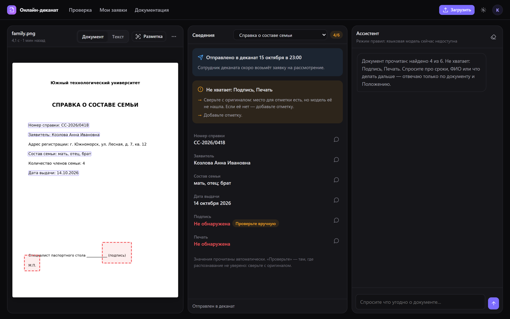

</div>

---

## Содержание

- [Что это](#что-это)
- [Возможности](#возможности)
- [Роли и путь заявки](#роли-и-путь-заявки)
- [Как это работает](#как-это-работает)
- [Модели](#модели)
- [Качество и скорость](#качество-и-скорость)
- [Быстрый старт](#быстрый-старт)
- [Структура репозитория](#структура-репозитория)
- [Данные](#данные)
- [Документация](#документация)
- [Ограничения](#ограничения)
- [Лицензии](#лицензии)

## Что это

Студент загружает справку или заявление — и через несколько секунд видит, всё ли в нём на месте. Сервис:

- читает документ и находит поля: ФИО, даты, номер, организацию и т. д.;
- находит подпись и печать, а если их нет — **подсвечивает место на странице, где они должны быть** («(подпись)», «М.П.»);
- проверяет комплектность по Положению и называет недостающие пункты;
- сверяет ФИО в документе с ФИО в профиле студента;
- отвечает на вопросы о документе в чате.

Дальше студент отправляет заявку в деканат. Сотрудник видит её во входящих, открывает, одобряет или возвращает с комментарием. Окончательное решение всегда принимает человек: сервис выполняет только предварительную проверку.

Встроенные типы документов (правила кейса — в [`configs/participant_v1.json`](configs/participant_v1.json)):

| Тип | Ключ | Обязательные сведения |
| --- | --- | --- |
| Справка об обучении | `study_certificate` | ФИО, вуз, направление, форма обучения, начало и окончание обучения, номер, дата выдачи, подпись, печать |
| Заявление на академический отпуск | `academic_leave_application` | ФИО, группа, курс, причина, начало и окончание отпуска, дата заявления, подпись студента |
| Справка о практике | `internship_certificate` | ФИО, организация, начало и окончание практики, руководитель, оценка, номер, дата выдачи, подпись, печать |

Новые типы администратор добавляет сам, без обучения модели, — в [конструкторе](#конструктор-типов-документов).

Форматы: PNG, JPG и PDF до 10 МБ.

## Возможности

| | |
| --- | --- |
| **Быстро на CPU** | 4,2 с на страницу на Ryzen 5 3600 (6 потоков, FP32, без квантования). Видеокарта не нужна |
| **Заявки в деканат** | Черновик → отправлен → на рассмотрении → одобрен / возвращён. Замена файла внутри той же заявки, полный журнал событий, закрытие после многих попыток |
| **Честное предупреждение** | Перед отправкой неполного документа: «Мы проверили документ: в нём не хватает подписи руководителя практики и печати организации — этого требуют пункты 5.2 и 5.3 Положения. С таким документом заявление, скорее всего, вернут…». Отправить всё равно можно |
| **Подсветка недостающего** | Красная пунктирная рамка там, где на бланке напечатано «(подпись)» или «М.П.», но отметки нет |
| **Сверка ФИО** | ФИО из документа сравнивается с профилем (с учётом падежей). Несовпадение — красная отметка и для студента, и для деканата |
| **Живая камера** | Наведите телефон на документ: тип и поля подсвечиваются прямо на видео (~2–3 с на кадр), подсказки «темно», «нерезко», «блик», «держите неподвижно» считаются в браузере |
| **Редактор** | Поставить свою подпись, добавить текст, закрасить область — с полупрозрачным «призраком» под курсором. Деканат ставит электронную печать. Каждая правка — новая версия, оригинал сохраняется, деканат видит пометку «изменён в редакторе» |
| **Конструктор типов** | Новый вид документа без обучения: фразы из заголовка, поля с подписями, обязательные отметки, пункт Положения |
| **Входящие деканата** | Счётчики, фильтры по статусу, типу и группе, поиск. Выгрузка в Excel (с тем, кто и когда принял решение) и PDF-протокол проверки |
| **Роли и приглашения** | Студент, сотрудник деканата, суперадмин. Сотрудники регистрируются только по одноразовой ссылке-приглашению |
| **Ассистент** | Локальная Qwen3.5-4B через Ollama. На CPU прямые вопросы («какой номер справки?», «чего не хватает?») отвечаются правилами мгновенно, модель — только для свободных вопросов |
| **REST API и авто-одобрение** | Ключи `dk_live_…`, загрузка, результаты, чат. Авто-одобрение полных документов — настройка профиля |
| **Сайт на сервере, вычисления дома** | Сервер без видеокарты может отдавать распознавание и чат на свой компьютер через исходящее WebSocket-соединение. Компьютер выключен — сервер распознаёт сам |

<table>
<tr>
<td width="50%">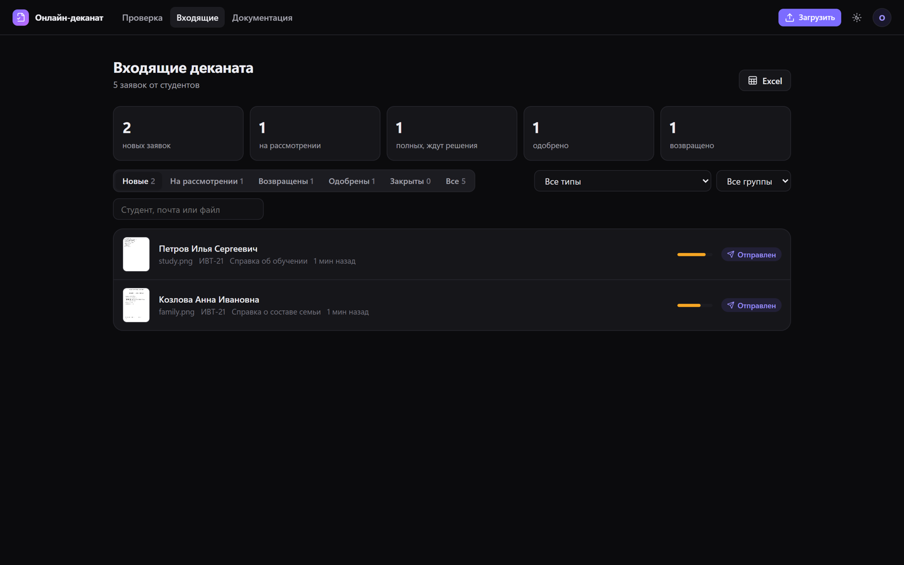</td>
<td width="50%">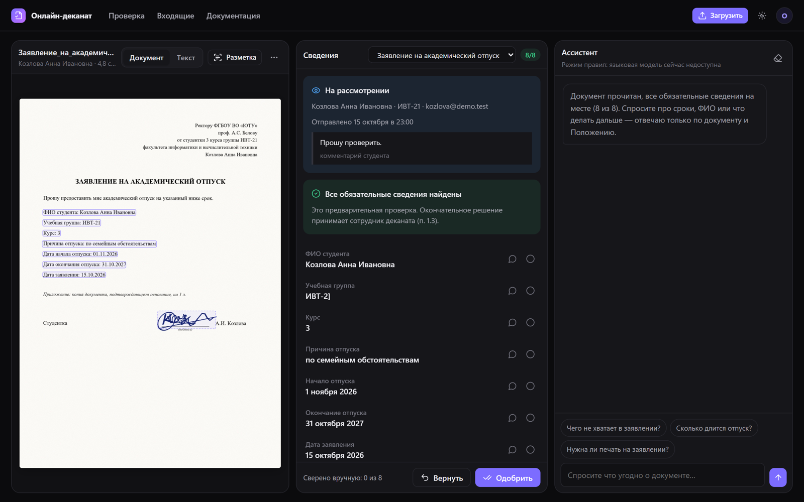</td>
</tr>
<tr>
<td align="center"><sub>Входящие деканата: счётчики, фильтры по типу и группе, Excel</sub></td>
<td align="center"><sub>Заявка глазами сотрудника: комментарий студента, «Вернуть» / «Одобрить»</sub></td>
</tr>
<tr>
<td width="50%">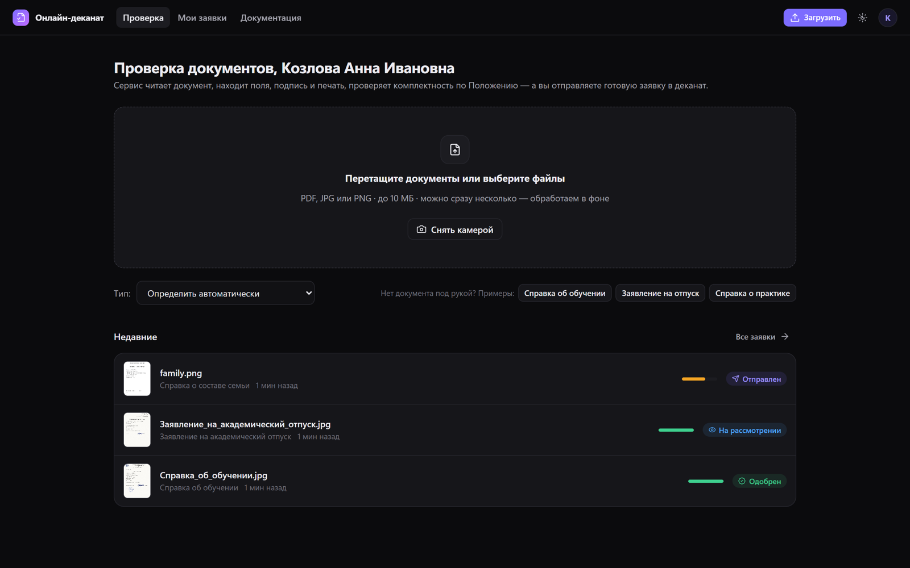</td>
<td width="50%">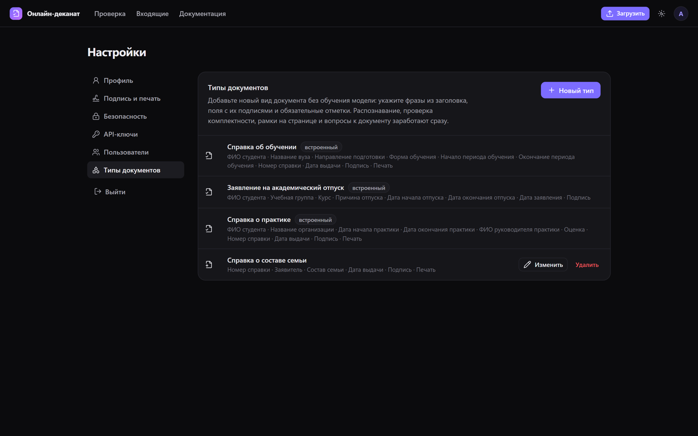</td>
</tr>
<tr>
<td align="center"><sub>Загрузка: перетаскивание, несколько файлов, съёмка камерой</sub></td>
<td align="center"><sub>Конструктор: встроенные и добавленные типы</sub></td>
</tr>
</table>

## Роли и путь заявки

| Роль | Как появляется | Что может |
| --- | --- | --- |
| **Студент** | Регистрируется сам: ФИО «как в документах» и группа | Загружать, проверять, править свои документы, ставить **свою** подпись, отправлять в деканат |
| **Сотрудник деканата** | Только по одноразовой ссылке от суперадмина (действует 7 дней) | Входящие, решения, комментарии, электронная печать деканата, закрытие заявок, Excel и PDF |
| **Суперадмин** | Назначается на сервере | Всё перечисленное + приглашения, роли пользователей, конструктор типов |

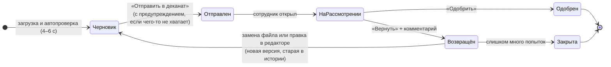

Каждый шаг пишется в журнал заявки: загружен, проверен автоматически, отправлен, взят на рассмотрение, возвращён, заменён файл, изменён в редакторе, одобрен, закрыт — кто и когда.

## Как это работает

### Быстрый CPU-движок (по умолчанию)

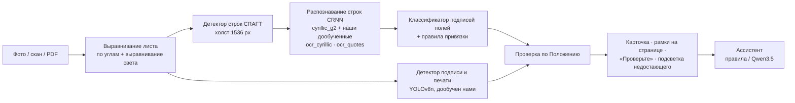

1. **Подготовка.** Лист находится по углам и выпрямляется по перспективе, неравномерное освещение выравнивается. Повороты на 90° и 180° вне условий кейса, поиск ориентации выключен ради скорости.
2. **Текст.** Детектор CRAFT ищет строки на холсте 1536 px: 1024 теряет даты, 2000 медленнее без выигрыша. Строки распознаются пакетами по 32. Цифровые поля перечитываются дообученной моделью `ocr_cyrillic.pt`, поля в «ёлочках» — моделью `ocr_quotes.pt`.
3. **Поля.** Классификатор узнаёт подписи полей («ФИО студента:», «Дата выдачи») по символьным n-граммам. Значения берутся справа от подписи или строкой ниже. Нормализация чинит типичные ошибки OCR: латинские буквы-двойники, «0» вместо «О» в префиксе номера, «]» вместо «1» в коде группы, кавычки.
4. **Подпись и печать.** YOLOv8n, дообученный на подписях и печатях. Если отметки нет, движок ищет напечатанное место для неё («(подпись)», «М.П.») и возвращает его рамку.
5. **Уверенность.** Значение с уверенностью распознавания ниже 0,5 помечается «Проверьте».
6. **Проверка.** Обязательность полей и пункты Положения берутся из конфигурации. Документ не «принимается» автоматически.

### Живая камера

Браузер четыре раза в секунду считает по уменьшенному кадру яркость, долю пересвеченных пикселей, резкость (дисперсия лапласиана) и сдвиг между кадрами. Каждые 2–3 секунды кадр (до 1280 px) уходит на `POST /api/live/scan`: тот же движок в быстром режиме (холст детектора 1024) возвращает тип, поля и рамки. Рамки переводятся из координат выпрямленного листа обратно в координаты кадра через обратную матрицу перспективы и рисуются поверх видео. Кадры нигде не сохраняются.

### Конструктор типов документов

Администратор описывает тип в форме:

- название;
- фразы из заголовка («справка о составе семьи»). Сравнение идёт по основам слов, поэтому «состав семьи» находит и «о составе семьи»;
- поля: название, варианты подписи на бланке, вид значения (текст, ФИО, дата, номер), обязательность;
- нужна ли подпись и печать;
- пункт Положения.

Обучение не нужно: движок находит подписи полей в распознанном тексте и берёт значение рядом, отметки ищет тот же детектор. Однословная фраза («справка») не перехватывает документы, которые уже узнаны как встроенный тип. Проверка комплектности, рамки, предупреждения, Excel и чат для нового типа работают сразу.

### PaddleOCR-VL (необязательный GPU-движок)

Исследовательская ветка проекта — одна визуально-языковая модель на всё: PaddleOCR-VL 1.6 (0,9 млрд параметров) с нашим LoRA-адаптером и головами подписи и печати. Собственный декодер со статическим KV-кэшем и CUDA graph даёт 3,5 с на странице на GPU. На CPU эта модель тратит около 2 минут на страницу, поэтому по умолчанию используется быстрый движок. Включается флагом `--engine gpu`. Подробно: [docs/model.md](docs/model.md).

## Модели

| Модель | Что делает | Происхождение | Размер |
| --- | --- | --- | --- |
| CRAFT (`craft_mlt_25k`) | Находит строки текста на странице | EasyOCR, используется как есть | 79 МБ |
| CRNN `cyrillic_g2` | Распознаёт строку кириллицы | EasyOCR, используется как есть | 15 МБ |
| [`ocr_cyrillic.pt`](models/) | Перечитывает цифровые поля: даты, номера, курс | **дообучена нами** из `cyrillic_g2` на синтетике | 15 МБ |
| [`ocr_quotes.pt`](models/) | Перечитывает названия в кавычках: вуз, организация, оценка | **дообучена нами** из `ocr_cyrillic.pt` | 15 МБ |
| [`marks.pt`](models/) | Наш детектор подписи и печати (архитектура YOLOv8n от Ultralytics) | **дообучен нами** с весов COCO на подписях и процедурных печатях | 6,5 МБ |
| [`fields.joblib`](models/) | Узнаёт подписи полей в строках (TF-IDF по символам + логистическая регрессия) | **обучен нами** с нуля | 0,6 МБ |
| [`unified-experimental-natural-v5`](models/unified-experimental-natural-v5) | LoRA языковой части PaddleOCR-VL: чтение русских документов | **дообучен нами**, GPU-движок | 2,5 МБ |
| [`unified-experimental-mark-patches-v1`](models/unified-experimental-mark-patches-v1) | Патч-голова подписи и печати с рамками на признаках PaddleOCR-VL | **обучена нами**, GPU-движок | 1,3 МБ |
| PaddleOCR-VL 1.6 | Базовая модель GPU-движка, скачивается отдельно | PaddlePaddle, используется как есть | 1,9 ГБ |
| `qwen3.5:4b` | Ассистент в чате, через Ollama | Qwen, используется как есть (без дообучения) | 3,3 ГБ |

Каталог со всеми весами, включая экспериментальные и отклонённые адаптеры: [models/README.md](models/README.md).

## Качество и скорость

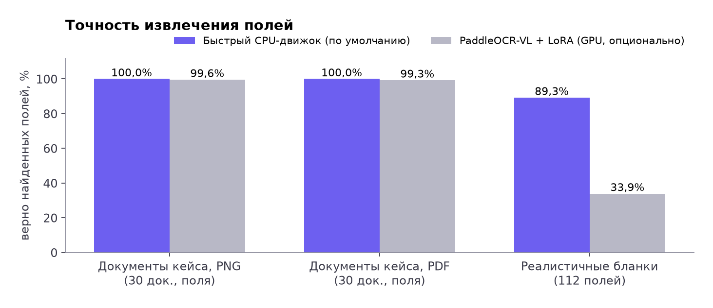

| Набор | Быстрый CPU-движок | PaddleOCR-VL + LoRA (GPU) |
| --- | --- | --- |
| Документы кейса, PNG: поля / комплектность / вопросы | **100% / 100% / 100%** | 99,6% / 100% / 100% |
| Документы кейса, PDF: поля / комплектность / вопросы | **100% / 100% / 100%** | 99,3% / 100% / 100% |
| Реалистичные бланки с фото, 112 полей | **100 верно, 1 ошибка** | 38 верно |

Документы кейса — синтетический набор организаторов: 30 документов, каждый в PNG и PDF. Он использовался **только для оценки**, в обучение не входил. Оценка — официальным `evaluate.py` из набора. Честная оговорка: несколько правил нормализации (кавычки, буквы-двойники) добавлены после разбора ошибок на этом наборе, поэтому 100% на нём — оценка сверху. Реалистичные бланки — отдельные фото вымышленных документов с рукописными подписями, тенями и перспективой.

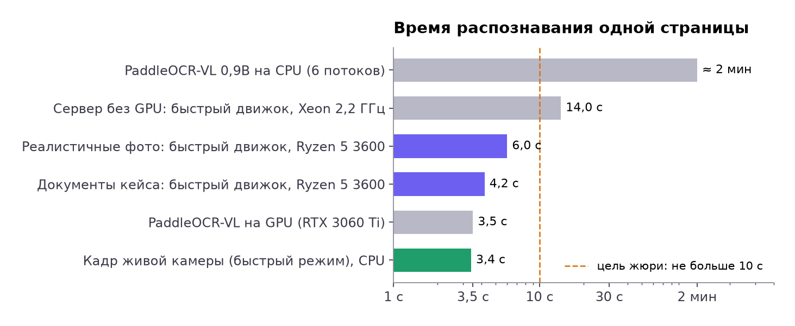

| Скорость | |
| --- | --- |
| Документ кейса, CPU Ryzen 5 3600 | **4,2 с** в среднем (PNG), 4,4 с (PDF), максимум 4,7 с |
| Фото реалистичного бланка, тот же CPU | около 6 с |
| Кадр живой камеры | 2–3,5 с |
| Сервер без GPU (Xeon 2,2 ГГц, 5 потоков) | около 14 с |
| PaddleOCR-VL на GPU RTX 3060 Ti | 3,5 с |

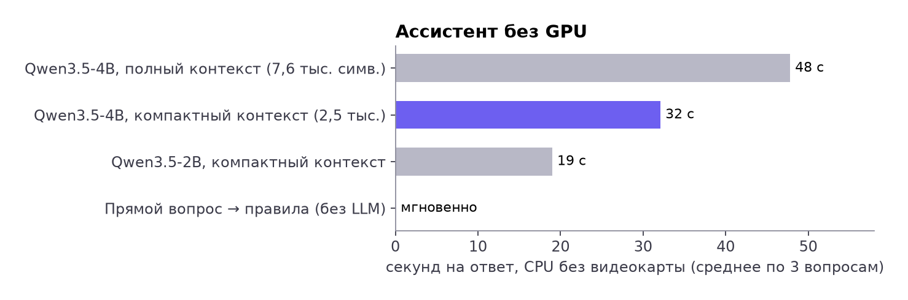

Без видеокарты даже небольшая языковая модель отвечает 20–50 секунд: почти всё время уходит на чтение длинного контекста. Поэтому на CPU ассистент работает в двух режимах. Прямые вопросы — значение поля, комплектность, кто принимает решение — сразу отвечает движок правил. Свободные вопросы идут в Qwen3.5-4B с компактным контекстом: поля плюс относящиеся к вопросу пункты Положения, без полного OCR-текста. Модель 2B быстрее, но чаще ошибалась, поэтому оставлена 4B. На GPU ответ занимает около 2 секунд.

Методика и все сравнения: [docs/evaluation.md](docs/evaluation.md).

## Быстрый старт

### 1. Окружение

```bash
git clone https://github.com/Stepa-Karpik/hack.git
cd hack
python -m venv .venv
```

На Windows окружение активируется командой `.venv\Scripts\activate`, на Linux и macOS — `source .venv/bin/activate`.

```bash
pip install torch torchvision --index-url https://download.pytorch.org/whl/cpu
pip install -r requirements.txt -r requirements-app.txt
```

Для быстрого движка этого достаточно: веса EasyOCR и наши модели лежат в [`models/`](models/README.md).

### 2. Ассистент (необязательно)

Нужна [Ollama](https://ollama.com):

```bash
ollama pull qwen3.5:4b
```

Без Ollama чат отвечает движком правил.

### 3. Запуск

```bash
python -m scripts.app.server --port 8502 --engine cpu
```

Откройте http://127.0.0.1:8502. Данные (SQLite и файлы) сохраняются в `work/app-v1`. Первому администратору роль назначается на сервере (`UPDATE users SET role='admin' …`), дальше он приглашает сотрудников ссылками. На Windows то же самое делает `launch-app.ps1`.

Для живой камеры с телефона сайт должен открываться по HTTPS: браузеры дают доступ к камере только на `https://` и `localhost`.

### 4. Результаты для проверки кейса

```bash
python -m scripts.app.make_results --kit <папка набора> --output results.json --engine cpu --variant image
```

Обрабатываются все документы и вопросы набора. Результат — `results.json` в формате кейса.

### 5. Публичный сервер + вычисления дома

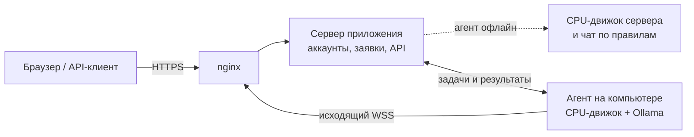

Сервер: `bash deploy/app-v2/install.sh app-v2.tar.gz`, по этапам `release venv model service nginx`. Компьютер: `launch-agent.ps1` или

```bash
python -m scripts.app.agent --server wss://<домен>/agent/ws --token-file work/agent-v1/agent-token
```

Подробно: [docs/deployment.md](docs/deployment.md).

### 6. Тесты

```bash
python -m pytest -q
```

566 тестов. Модели в тестах заменены заглушками, поэтому веса и GPU не нужны.

## Структура репозитория

```text
├── scripts/
│   ├── app/              веб-приложение: сервер, заявки, роли, CPU-движок (fast_worker), конструктор типов,
│   │                     Excel/PDF, живая камера, агент и брокер
│   ├── assistant/        ассистент: контекст (полный и компактный), схема ответа, проверка привязки
│   ├── unified/          GPU-движок PaddleOCR-VL: чтение, граф-декодер, головы, обучение, генераторы данных
│   ├── participantkit/   контракт кейса: формат результата, правила, адаптеры
│   └── *.py              обучение моделей CPU-движка (OCR, детектор, классификатор), утилиты
├── dekanat/              библиотека CPU-движка: предобработка, OCR, извлечение, отметки, правила
├── web-app/              интерфейс: ES-модули без сборки (проверка, входящие, редактор, камера, конструктор)
├── configs/              Положение кейса и схемы документов
├── models/               собственные и дообученные модели
├── deploy/               развёртывание: systemd, nginx, установка, сборка релиза
├── tests/                566 тестов
└── docs/                 документация
```

Полная карта кода: [docs/development.md](docs/development.md).

## Данные

Обучающие данные — **собственная синтетика** с вымышленными людьми и организациями:

- генераторы страниц: `dekanat/synthetic.py`, `scripts/unified/prepare_*.py`;
- фамилии из Wikidata (CC0);
- предложения из русской Википедии (CC BY-SA 4.0);
- реальные подписи из набора Ultralytics Signature (AGPL-3.0);
- процедурные печати.

Документы организаторов и реальные бенчмарки используются только для оценки. Наборы данных в репозиторий не входят: их можно воспроизвести генераторами. Подробно: [docs/training.md](docs/training.md).

## Документация

| Раздел | Содержание |
| --- | --- |
| [Приложение](docs/app.md) | Роли, заявки, редактор, камера, конструктор, входящие, выгрузки |
| [Архитектура](docs/architecture.md) | Компоненты, путь документа, хранение, безопасность, протокол агента |
| [Модель](docs/model.md) | GPU-движок: PaddleOCR-VL, адаптер, головы, граф-декодер |
| [Прежнее поколение / CPU-движок](docs/legacy.md) | Конвейер EasyOCR + YOLO + правила |
| [Данные и обучение](docs/training.md) | Генераторы, источники и лицензии, проверки утечек, рецепты |
| [Оценка](docs/evaluation.md) | Наборы, метрики, результаты |
| [Ассистент](docs/assistant.md) | Устройство чата, проверка привязки, режимы CPU и GPU |
| [REST API](docs/api.md) | Эндпоинты, авторизация, примеры |
| [Развёртывание](docs/deployment.md) | Локально, сервер, агент, nginx, откат |
| [Разработка](docs/development.md) | Окружения, тесты, карта кода |
| [История исследования](docs/research.md) | Все эксперименты, включая отклонённые |

## Ограничения

- Рукописный текст полей не распознаётся (рукописная подпись — распознаётся как отметка).
- Многостраничные PDF не поддерживаются: нужна одна страница.
- Повороты на 90° и 180° не исправляются: снимайте документ ровно.
- Конструктор типов рассчитан на бланки вида «Подпись поля: значение». Свободный текст без подписей полей заполняется плохо.
- Обнаружение подписи или печати не проверяет их подлинность.
- Редактор позволяет ставить только свою подпись, а печать деканата — только сотрудникам. Каждая правка видна деканату, оригинал сохраняется.
- Проверка предварительная. Решение принимает сотрудник деканата.

## Лицензии

Код и собственные модели распространяются под [AGPL-3.0](LICENSE): детектор подписи и печати дообучен с помощью Ultralytics YOLOv8 (AGPL-3.0). Сторонние компоненты:

| Компонент | Лицензия |
| --- | --- |
| EasyOCR (CRAFT, CRNN) | Apache-2.0 |
| Ultralytics YOLOv8 | AGPL-3.0 |
| PaddleOCR-VL 1.6 | Apache-2.0 |
| Qwen3.5 | Apache-2.0 |
| DejaVu (шрифты PDF-протокола) | лицензия DejaVu (свободная, на основе Bitstream Vera) |
| Notyf | MIT |
| Lucide | ISC |
| Wikidata | CC0 |
| Википедия | CC BY-SA 4.0 |

Все имена, организации и документы в примерах вымышлены.
