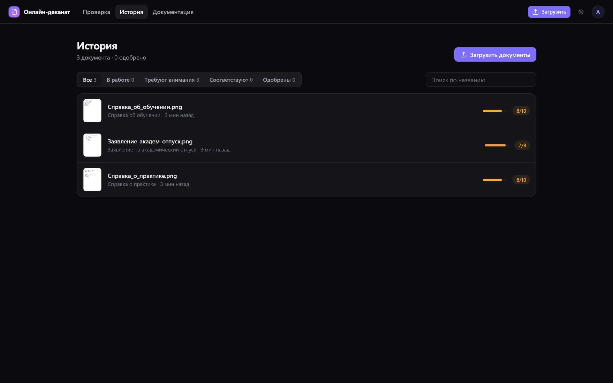

# Приложение

Одностраничное приложение `web-app/`: ES-модули без сборки. Подключены [Notyf](https://github.com/caroso1222/notyf) 3.10 (MIT) для уведомлений и [Lucide](https://lucide.dev) 0.469 (ISC) для иконок. Есть тёмная и светлая темы.

## Адреса

| Адрес | Страница |
| --- | --- |
| `/` | Загрузка: перетаскивание нескольких файлов, тип «авто» или вручную, примеры документов, недавние проверки |
| `/check/<id>` | Документ: страница целиком на экране, разметка, поля, «Проверьте», сверка, одобрение, чат |
| `/history` | История: превью, прогресс `9/10`, фильтры по статусу, поиск |
| `/profile` | Имя, почта, авто-подтверждение |
| `/profile/security` | Смена пароля, выход |
| `/profile/api` | API-ключи |
| `/login`, `/register` | Вход и регистрация |
| `/docs`, `/docs/statuses`, `/docs/api`, `/docs/assistant` | Встроенная документация |

Ссылка на документ имеет вид `/check/aot3515lh-151g115-f12gs`: 21 случайный символ base36, группы 9-7-5. Открыть документ может только его владелец.

## Страница документа

**Левая панель — документ:**

- вкладки «Документ» и «Текст» (распознанный текст);
- переключатель «Разметка»: рамки полей, подписи и печати; клик по полю подсвечивает его на странице;
- открыть оригинал, скопировать ссылку, удалить.

Страница масштабируется так, чтобы одностраничный документ помещался на экране без прокрутки.

**Средняя панель — сведения:**

- **Тип документа.** Смена типа пересчитывает поля без повторного распознавания.
- **Счётчик** найденных сведений, например `8/10`.
- **Блок «Не хватает».** Недостающие сведения, подсказки, что сделать, и ссылки на пункты Положения.
- **Поля.** У каждого поля:
  - значение;
  - «Проверьте», если модель не уверена (во всплывающей подсказке — уверенность);
  - кнопка «Спросить ассистента» про это поле;
  - галочка «Сверено». Галочки сохраняются для документа.
- **Внизу:**
  - «Сверено вручную: N из M»;
  - «Сводка» — скачать текстовую сводку проверки;
  - «Одобрить» и отмена одобрения.

**Правая панель — ассистент:**

- приветствие с итогом проверки;
- ответы с видом («Найдено в документе», «Вычислено по документу»…), источниками и временем;
- подсказки следующих вопросов;
- очистка истории.

Пока документ обрабатывается, на странице видны таймер и позиция в очереди. Без GPU показывается предупреждение, что распознавание займёт 1–3 минуты.

## Статусы

| Статус | Значение |
| --- | --- |
| В очереди · N | Ждёт распознавания, N — позиция |
| Распознаётся | Модель читает документ |
| `9/10` | Найдено 9 из 10 обязательных сведений, документ требует внимания |
| Соответствует | Все обязательные сведения найдены (10/10) |
| Одобрен | Пользователь одобрил документ вручную (или через API) |
| Одобрен автоматически | Сработало авто-подтверждение |
| Ошибка | Не удалось распознать: многостраничный PDF, повреждённый файл |

**Авто-подтверждение** включается в профиле. При открытии документа, который соответствует требованиям, он сразу отмечается «Одобрен автоматически». Через API авто-подтверждение не срабатывает: там документы одобряются явно.

## История

На странице истории:

- вкладки «Все», «В работе», «Требуют внимания», «Соответствуют», «Одобрены»;
- поиск по названию файла;
- у каждого документа превью и полоса прогресса.

## Загрузка и уведомления

- До 20 файлов за раз, каждый до 10 МБ: PNG, JPG или одностраничный PDF.
- Файлы обрабатываются в фоне по очереди. Можно уйти со страницы.
- Когда документ готов, приходит уведомление в интерфейсе: «Все обязательные сведения найдены» или «Не хватает: …». Если вкладка свёрнута, приходит системное уведомление браузера (с разрешения пользователя).
- Ошибки показываются уведомлениями с понятным русским текстом: «Файл пустой или больше 10 МБ», «Многостраничный PDF пока не поддерживается: загрузите одну страницу».

## Профиль и API-ключи

- Имя, почта, переключатель «Авто-подтверждение открытых документов».
- Смена пароля: остальные сессии завершаются, текущая продолжается с новым токеном.
- Выход.
- API-ключи: создание с названием (ключ показывается один раз), список с датой последнего использования, удаление. Рядом ссылка «Документация API».

Описание API: [api.md](api.md).

## Код

| Файл | |
| --- | --- |
| `web-app/index.html` | Каркас, подключение стилей и скриптов |
| `web-app/assets/app.css` | Дизайн-токены, темы, сетка рабочей области |
| `web-app/assets/js/ui.js` | Создание элементов, иконки, уведомления, API-клиент с русскими ошибками, названия полей и типов |
| `web-app/assets/js/main.js` | Маршрутизация, верхняя панель, загрузка, отслеживание готовности |
| `web-app/assets/js/chat.js` | Чат с потоковым ответом |
| `web-app/assets/js/pages/*.js` | Страницы |
