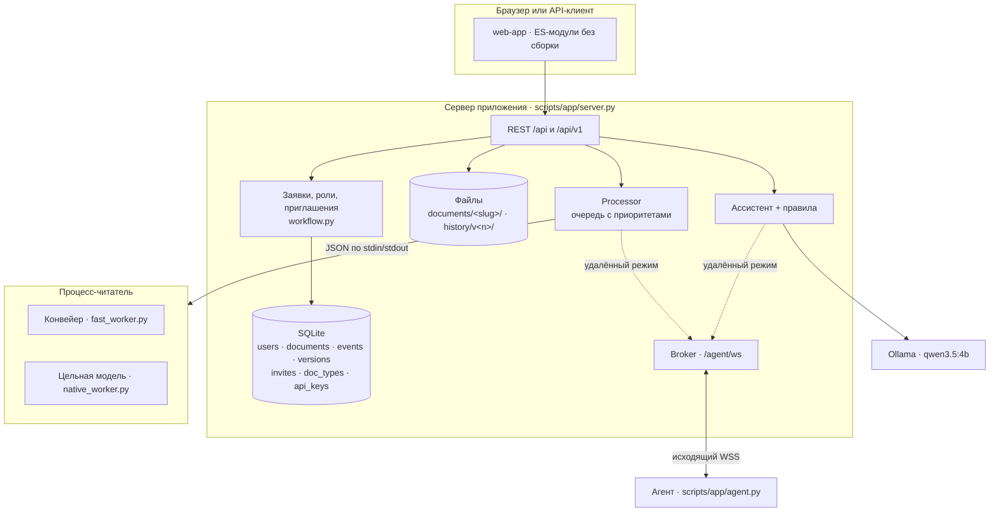
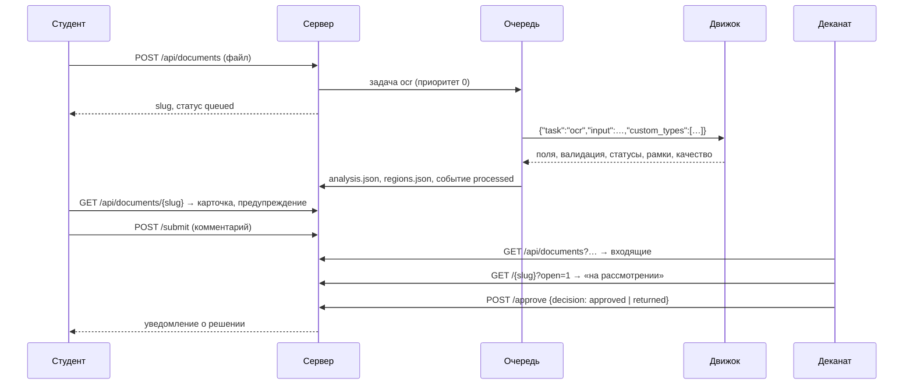
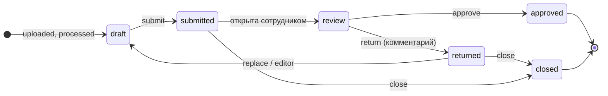

# Архитектура

Онлайн-деканат состоит из четырёх частей:

| Часть | Назначение | Где работает |
| --- | --- | --- |
| **Веб-приложение** | Аккаунты, роли, заявки, входящие деканата, API, интерфейс | Сервер (Starlette + SQLite) |
| **Движок распознавания** | Тип документа, поля, подпись и печать, рамки | Отдельный процесс-читатель на сервере или на агенте |
| **Ассистент** | Ответы на вопросы по распознанному документу | Ollama на сервере или на агенте; без неё — движок правил |
| **Агент** (необязательно) | Выполняет распознавание и чат на отдельном компьютере | Подключается к серверу исходящим WebSocket |

## Компоненты

| Модуль | Ответственность |
| --- | --- |
| `scripts/app/server.py` | Маршруты, авторизация и роли, загрузка, заявки, экспорт, живая камера, потоковый чат, раздача интерфейса |
| `scripts/app/store.py` | SQLite на стандартной библиотеке: пользователи, сессии, ключи, документы, события, версии, приглашения, типы |
| `scripts/app/workflow.py` | Состояния заявки и события, текст предупреждения, сверка ФИО, Excel, PDF-протокол |
| `scripts/app/processing.py` | Очередь задач, процессы-читатели (`FastReader`, `Reader`), выбор устройства |
| `scripts/app/fast_worker.py` | Конвейер: распознавание, поля, рамки, места недостающих отметок, читаемость, быстрый режим для камеры |
| `scripts/app/custom_types.py` | Типы из конструктора: проверка формы, распознавание по заголовку, извлечение полей |
| `scripts/app/pipeline.py` | Приведение ответа движка к карточке документа: поля, статусы, «Проверьте», отметки |
| `scripts/app/remote.py` | Брокер агента, удалённый читатель с ожиданием переподключения и прогретым резервом, удалённый чат |
| `scripts/app/agent.py` | Агент: исходящее соединение, выполнение задач на локальном движке и Ollama |
| `scripts/assistant/core.py` | Контекст (полный и компактный), JSON-схема ответа, проверка привязки |
| `scripts/participantkit/` | Контракт кейса: формат результата, правила, адаптеры, `make_results` |
| `dekanat/` | Библиотека конвейера: предобработка, OCR, извлечение, отметки, проверка дат |
| `scripts/unified/` | Цельная модель: чтение, собственный декодер, головы, привязка полей, обучение |

## Путь документа

1. **Загрузка.** Файл сохраняется в `documents/<slug>/input.*`, создаётся заявка в состоянии «черновик» и событие `uploaded`.
2. **Распознавание.** Очередь передаёт задачу процессу-читателю. Вместе с задачей передаются конфигурации типов из конструктора. Читатель возвращает строку результата: тип, поля, проверку комплектности, статусы, уверенность, рамки и оценку читаемости. Выпрямленная страница сохраняется как `preview.png`: это геометрия всех рамок.
3. **Карточка.** `pipeline.analyze_fast` приводит результат к единому формату. Сохраняются `analysis.json` и `regions.json`, пишется событие `processed`.
4. **Отправка.** Студент отправляет заявку. Если чего-то не хватает, он видит предупреждение (`workflow.submit_warning`).
5. **Решение.** Сотрудник открывает заявку, и она переходит в состояние «на рассмотрении». Затем сотрудник одобряет или возвращает её с комментарием.
6. **Повторная попытка.** Замена файла или правка в редакторе архивирует прежнюю версию в `history/v<n>/` и запускает распознавание заново.

## Состояния заявки

## Хранение

| Данные | Где |
| --- | --- |
| Пользователи, роли, сессии, ключи API | `app.sqlite3`: `users`, `sessions`, `api_keys` |
| Заявки | `documents`: состояние, попытки, версия, решение, комментарии |
| Журнал | `events`: тип события, автор, время, подробности |
| Версии файлов | `versions` + `documents/<slug>/history/v<n>/` |
| Приглашения | `invites`: одноразовый токен (хранится хэш), роль, срок, кем использовано |
| Типы из конструктора | `doc_types`: ключ, название, JSON-конфигурация |
| Подписи и печати профиля | `profiles/<user_id>/signature.png`, `seal.png` |

## Протокол агента

Агент подключается к `wss://<домен>/agent/ws` с токеном в заголовке `Authorization: Bearer`. Сообщения — JSON:

| Направление | Сообщение |
| --- | --- |
| агент → сервер | `hello` с `info`: имя хоста, GPU, доступность ассистента, режим `compact` |
| сервер → агент | `task`: `ocr` / `chat` / `warm` с данными (файл в base64, тип, типы из конструктора, флаг `quick`) |
| агент → сервер | `chunk` (поток чата), `result` (`output` и `preview` в base64), `error` |
| обе стороны | `ping` / `pong` |

Сервер устойчив к потере агента:

- **Короткий разрыв.** Если связь пропала меньше минуты назад или сервер только что запустился, задача до 20 секунд ждёт переподключения агента.
- **Агент выключен.** Задача выполняется резервным CPU-движком сервера. Резерв загружается при старте службы, поэтому холодного старта нет.
