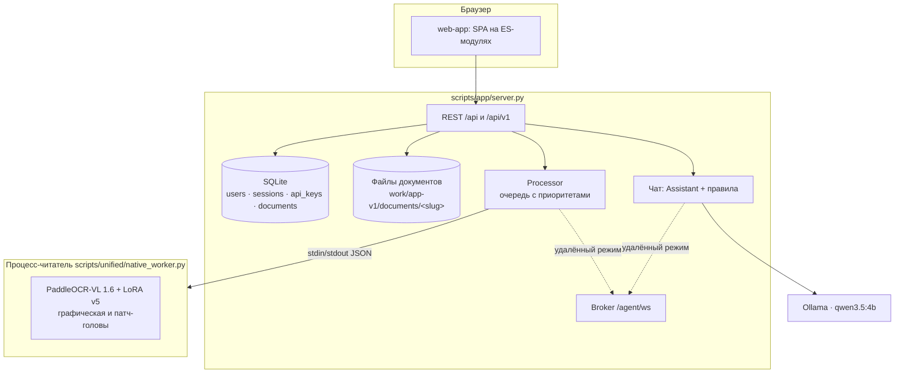
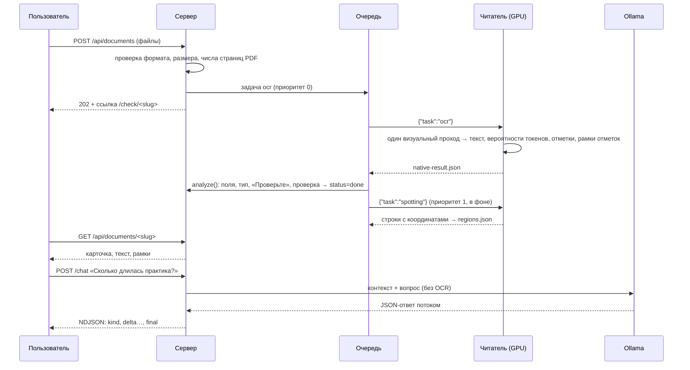
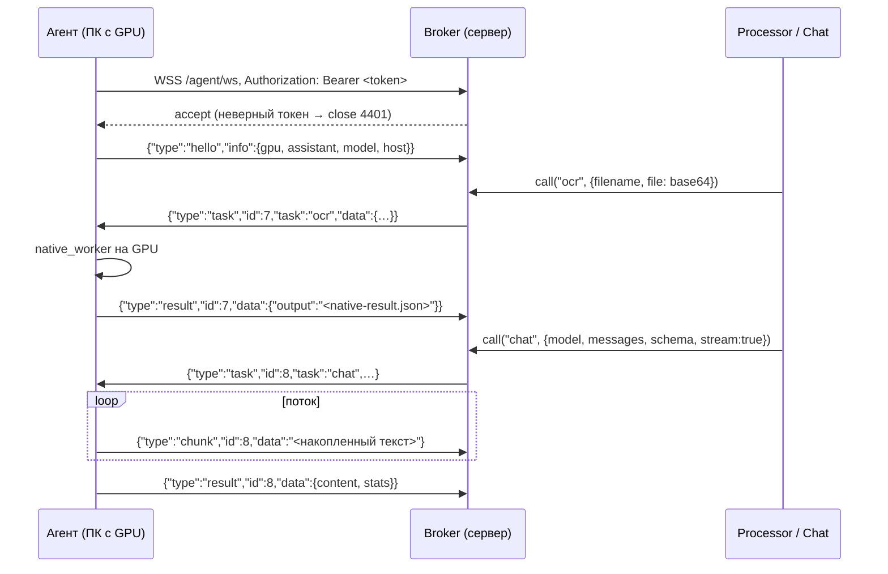

# Архитектура

Система состоит из трёх частей:

- **модель** — PaddleOCR-VL 1.6 с адаптером и двумя графическими головами, работает в отдельном процессе-читателе;
- **приложение** — Starlette-сервер с SQLite, очередью задач и одностраничным интерфейсом;
- **ассистент** — локальная языковая модель в Ollama, которая отвечает по уже распознанному результату.

В публичной установке модель и ассистент работают на компьютере с видеокартой. Он подключается к серверу как **GPU-агент**.

## Компоненты

| Модуль | Ответственность |
| --- | --- |
| `scripts/app/server.py` | Маршруты, авторизация, загрузка, выдача результатов, потоковый чат, раздача интерфейса |
| `scripts/app/store.py` | SQLite (только стандартная библиотека): пользователи, сессии, API-ключи, документы |
| `scripts/app/processing.py` | Очередь задач и процесс-читатель. Распознавание имеет приоритет 0, фоновая разметка — приоритет 1 |
| `scripts/app/pipeline.py` | Превращает ответ модели в карточку: поля, тип, уверенность, «Проверьте», отметки, рамки |
| `scripts/app/remote.py` | Сторона сервера для GPU-агента: брокер WebSocket, удалённый читатель, удалённый чат |
| `scripts/app/agent.py` | GPU-агент: исходящее соединение, выполнение задач на локальной модели и Ollama |
| `scripts/unified/native_worker.py` | Процесс-читатель: модель загружается один раз, дальше запросы по одному JSON на строку |
| `scripts/unified/fast_decode.py` | Граф-декодер: статический KV-кэш, CUDA graph одного шага, групповое внимание |
| `scripts/unified/text_binding.py`, `literal_layout.py`, `prose_binding.py` | Привязка значений к полям по прочитанному тексту |
| `scripts/unified/field_regions.py` | Рамки полей по строкам из задачи `Spotting:` |
| `scripts/assistant/core.py` | Контекст, JSON-схема ответа, проверка привязки, запасной ответ по правилам |
| `scripts/participantkit/format_v1.py` | Контракт кейса: формат результата, проверка комплектности, ответы по правилам |

## Путь документа

Что лежит в папке документа `work/app-v1/documents/<slug>/`:

| Файл | Содержимое |
| --- | --- |
| `input.<ext>` | Исходный файл |
| `preview.png` | Изображение для просмотра, до 1700×2200 |
| `native-result.json` | Ответ модели: сырой OCR, вероятности токенов, оценки отметок, рамки патч-головы, время |
| `analysis.json` | Карточка: поля, проверка, тип, уверенность, «Проверьте», аудит, текст после разметки строк |
| `regions.json` | Рамки полей и отметок, `status: pending / done / failed` |
| `chat.json` | История чата, последние 50 реплик |

Смена типа документа (`POST /type`) повторно применяет `analyze()` к сохранённому `native-result.json`. Модель при этом не вызывается.

## Очередь и процесс-читатель

- Процесс-читатель один и живёт постоянно. Модель загружается один раз, примерно за 10 с.
- Режим `--swap` для GPU: веса хранятся в оперативной памяти и переносятся на GPU на время чтения страницы. Перед этим модели Ollama выгружаются (`keep_alive: 0`), чтобы 8 ГБ видеопамяти хватало обеим моделям. После разметки, если очередь пуста, модель ассистента загружается снова в фоне.
- При нехватке видеопамяти чтение автоматически повторяется на CPU.
- Незаконченные документы после перезапуска сервера снова встают в очередь.
- Позиция в очереди видна в интерфейсе («В очереди · 3»).

## Хранение и безопасность

| Что | Как |
| --- | --- |
| Пароли | PBKDF2-SHA256, соль 16 байт, 240 000 итераций |
| Сессии | Случайный токен в cookie `HttpOnly`, `SameSite=Lax`, `Secure` за HTTPS. В базе хранится только SHA-256 токена. Срок 30 дней |
| API-ключи | `dk_live_…`, показываются один раз. В базе хранятся префикс и хэш |
| CSRF | Для запросов с cookie сверяется `Origin`. Запросы с `Authorization` идут без cookie |
| Доступ к документам | Только владельцу. Ссылка `/check/<slug>` — 21 случайный символ base36 (9-7-5) |
| Загрузка | PNG, JPG, PDF. До 10 МБ, до 20 файлов. Многостраничный PDF отклоняется до распознавания |
| Подбор пароля | Задержка 0,4 с при неверном входе; в nginx — лимит 10 запросов в минуту на `/api/auth/` |
| Заголовки | CSP только `self`, без inline-скриптов. HSTS, `X-Frame-Options: DENY`, `nosniff` |
| Внешние сервисы | Не вызываются. Документы обрабатываются только своими моделями |

## GPU-агент

Сервер без видеокарты принимает соединение от агента на `/agent/ws`. Агент подключается **сам** (исходящее WSS), поэтому на компьютере с GPU не нужно открывать порты.

| Задача | Что делает агент |
| --- | --- |
| `ocr` | Распознаёт файл тем же `native_worker` (GPU, swap) и возвращает `native-result.json` |
| `spotting` | Строки с координатами для разметки полей |
| `chat` | Запрос к локальной Ollama, части ответа приходят не чаще раза в 80 мс |
| `warm` | Загружает модель ассистента в память |

Правила работы связи:

- **Один агент.** Новое подключение закрывает предыдущее с кодом 4000.
- **Обрыв.** Ожидающие задачи получают `AgentOffline`. Распознавание продолжается на CPU сервера, чат переходит на движок правил.
- **Агент офлайн.**
  - Распознавание выполняет локальный CPU-читатель сервера. Он запускается при первой такой задаче.
  - Разметку текстовых полей сервер пропускает, чтобы не тратить минуты процессора. Рамки подписи и печати остаются: их даёт само распознавание.
  - Интерфейс предупреждает, что распознавание займёт 1–3 минуты.
- **Переподключение.** Агент переподключается сам с задержкой от 2 до 60 с. WebSocket-ping идёт каждые 20 с.
- **Текущий режим** показывает `GET /api/health`: `reader` = `gpu-agent` или `server-cpu`, `assistant` = `true` или `false`.

Код: [`scripts/app/remote.py`](../scripts/app/remote.py), [`scripts/app/agent.py`](../scripts/app/agent.py). Тест связи: `tests/test_app.py::test_remote_agent_link_and_cpu_fallback`.
