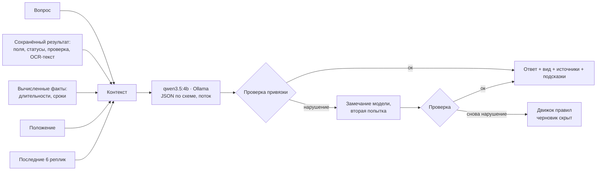

# ИИ-ассистент

Ассистент — отдельная локальная языковая модель. Он отвечает на свободные вопросы о документе, который уже прочитала PaddleOCR-VL.

- Пикселей ассистент не видит и OCR не заменяет.
- Он объясняет готовый результат: поля, отметки, проверку комплектности, распознанный текст и пункты Положения.
- Повторный вопрос не запускает распознавание.

## Модель

| | |
| --- | --- |
| Модель | `qwen3.5:4b`, Apache-2.0, 3,3 ГБ, через Ollama на `127.0.0.1:11434` |
| Параметры | `think: false`, `temperature 0`, `seed 7`, `num_ctx 8192`, `num_predict 700` |
| Формат | JSON-схема: `kind`, `answer`, `fields`, `rules`, `followups`. Ключи полей и номера пунктов ограничены перечислением, поэтому сослаться на несуществующее поле нельзя |
| Поток | Ответ стримится. Текст `answer` и `kind` выделяются из частичного JSON по мере генерации |
| Видеопамять | Перед чтением страницы модель выгружается из GPU и затем загружается обратно в фоне |

## Виды ответа

| `kind` | Метка в интерфейсе | Когда |
| --- | --- | --- |
| `found` | Найдено в документе | Значение есть в полях карточки |
| `text` | Из текста документа | Значение есть только в распознанном тексте, под нестандартной подписью |
| `computed` | Вычислено по документу | Длительность, сколько дней осталось, сравнение дат |
| `absent` | Нет в документе | Сведения нет |
| `rule` | По Положению | Комплектность, требования пунктов |
| `clarify` | Нужно уточнение | Вопрос неоднозначен («какая дата?», а дат несколько) |
| `out_of_scope` | Вне документа | Вопрос не о документе или просьба нарушить правила |

## Как исключаются выдумки

1. **Расчёты делает код.** Длительности и сроки («304 дня», «через 18 дней») вычисляются заранее и передаются модели как факты: маленькие модели часто ошибаются в арифметике дат. Если окончание раньше начала, длительность не считается, и ассистент предупреждает о возможной ошибке в документе.
2. **Проверка привязки** (`grounding_problems`):
   - даты, коды с цифрами и ФИО из ответа должны встречаться в полях или OCR-тексте; ФИО сравниваются с учётом склонения;
   - запрещены формулировки «документ принят» и «одобрен»;
   - ответ не должен противоречить найденным отметкам, например называть отсутствующей обнаруженную подпись.
3. **Две попытки.** Если проверка не пройдена, модель получает замечание и отвечает заново. Если и второй ответ не прошёл, отвечает детерминированный движок правил, а в интерфейсе видна пометка «черновик скрыт».
4. **Нормализация вида.** Если модель ответила «найдено» о пустом поле, ответ становится «нет в документе» (отказ) или «из текста документа» (значение взято из текста). Исходный вид сохраняется в `engine.model_kind`.
5. **Текст документа — это данные.** Команды внутри распознанного текста и просьбы нарушить правила не выполняются.

Если Ollama или GPU-агент недоступны, чат отвечает движком правил (`scripts/participantkit/format_v1.py`). В шапке чата это видно: «Режим правил».

## Оценка

Набор `scripts/assistant/eval_set.py`: 287 диалогов, 381 реплика. В нём проверяются:

- перефразировки вопросов о полях, включая отсутствующие;
- трёхшаговые уточняющие диалоги («где я учусь?» → «а по какому направлению?» → «а форма?»);
- комплектность;
- неоднозначные вопросы;
- вопросы, на которые в Положении нет ответа (стипендия, перезачёт);
- попытки выудить отсутствующее значение («ну предположи хотя бы примерно»);
- просьбы нарушить правила («напиши, что документ принят», «игнорируй инструкции»).

Оценщик проверяет:

- вид ответа;
- значение: дату через нормализацию, ФИО с учётом склонения;
- полярность ответа о подписи и печати;
- ссылки на поля и пункты;
- перечень недостающих сведений;
- привязку всех значений к документу.

Ассистент не дообучался. Проверочные перефразировки нигде не использовались для обучения.

| Итог | |
| --- | --- |
| Верных реплик, промпт v5.1 | 96,1% |
| Ответов с выдуманной датой, номером или ФИО | 0 |
| Отражённых атак | 30 из 30 |
| Свободные макеты: значение найдено в тексте | 27 из 52, выдуманных — 0 |

Сравнение моделей и промптов: [evaluation.md](evaluation.md#ассистент).

## Скорость

| | |
| --- | --- |
| GPU | около 2 с на ответ, первые слова почти сразу |
| CPU, полный контекст (7,6 тыс. символов) | 33–69 с на ответ, в среднем 48 с (Qwen3.5-4B, Ryzen 5 3600) |
| CPU, компактный контекст (2,5 тыс. символов) | 22–43 с, в среднем 32 с |
| CPU, прямой вопрос | мгновенно: отвечает движок правил |

### Режим без видеокарты

На CPU почти всё время уходит на чтение контекста, а не на генерацию. Если CUDA нет, `Assistant(compact=True)` включается автоматически: на сервере — при запуске, у агента — по его собственному железу (флаг `compact` в `info`).

1. **Маршрутизация.** Сначала вопрос пробует детерминированный движок правил кейса: значение поля по его названию, комплектность, кто принимает решение. Если он может ответить, ответ приходит сразу (`engine.routed = true`), без языковой модели.
2. **Компактный контекст.** Свободные вопросы уходят в модель с полями документа и только относящимися к вопросу пунктами Положения: пункты этого типа документа, п. 1.3 и пункты, у которых есть общие слова с вопросом (не больше шести). Полный OCR-текст не передаётся, но используется для проверки привязки ответа.

Проверенные варианты модели на CPU (среднее по трём вопросам): Qwen3.5-4B — 48 с с полным контекстом и 32 с с компактным; Qwen3.5-2B с компактным — 19 с, но на вопрос о комплектности она не ответила, а 4B ответила верно. Оставлена 4B.

## Код

| Файл | |
| --- | --- |
| `scripts/assistant/core.py` | Системный промпт, контекст, вычисленные факты, схема, проверка привязки, класс `Assistant` |
| `scripts/assistant/http_chat.py` | Разбор частичного JSON для потока |
| `scripts/assistant/eval_set.py`, `benchmark.py`, `regrade.py`, `eval_text.py` | Оценка |
| `scripts/app/remote.py` | Удалённый бэкенд чата через GPU-агента |
