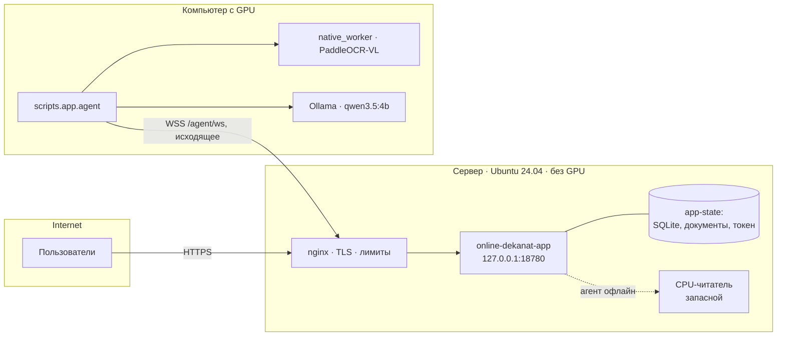

# Развёртывание

| Вариант | Где выполняется распознавание | Когда подходит |
| --- | --- | --- |
| **Локально, конвейер** | Тот же компьютер, CPU, `--engine cpu` (по умолчанию) | Любой компьютер; 4–6 с на страницу |
| Локально, цельная модель | Тот же компьютер, GPU, `--engine gpu` | Есть видеокарта с 8 ГБ; 3,5 с на страницу |
| **Сервер + агент** | Сервер принимает пользователей; распознавание и чат выполняет подключённый компьютер-агент, при его отсутствии — CPU сервера | Публичный сайт без аренды GPU |

## Локально

Подготовка окружения, базовой модели и Ollama — в [README](../README.md#быстрый-старт). Запуск:

```bash
python -m scripts.app.server --port 8502 --engine cpu
```

| Параметр | По умолчанию | |
| --- | --- | --- |
| `--base` | `work/paddle-vl-base-v1` | Базовая модель |
| `--adapter` | `models/unified-experimental-natural-v5` | Адаптер LoRA |
| `--head` | `models/unified-experimental-graphic-head-fp32-v3` | Глобальная графическая голова |
| `--mark-head` | — | Патч-голова; без неё рамок отметок нет |
| `--assistant-model` | `qwen3.5:4b` | Модель Ollama; пустое значение отключает ассистента |
| `--work` | `work/app-v1` | SQLite и файлы документов |
| `--engine` | `auto` | `cpu` (= `auto`) — конвейер; `gpu` — цельная модель; `vlm-cpu` — цельная модель на CPU, только для сравнения |
| `--cpu-python` | `work/venv` | Интерпретатор окружения конвейера |
| `--host`, `--port` | `127.0.0.1`, `8502` | |
| `--agent-token-file` | — | Режим сервера: принимать GPU-агента на `/agent/ws` |
| `--secure-cookies` | выкл. | Флаг `Secure` для cookie, если сервер работает за HTTPS |

Параметры `--base`, `--adapter`, `--head`, `--mark-head` относятся к цельной модели. Переменная `DEKANAT_THREADS` задаёт число потоков CPU, по умолчанию 6; остальные переменные конвейера — в [pipeline.md](pipeline.md#параметры-окружения).

На Windows то же делают `launch-app.ps1` и `launch-agent.ps1`. Каталог `work` можно переопределить переменной `DEKANAT_WORK`.

## Сервер + GPU-агент



Как устроен протокол агента: [architecture.md](architecture.md#gpu-агент).

### Установка на сервер

Требования: Ubuntu 22.04+ с Python 3.12, около 6 ГБ на диске (окружение и модель), 8+ ГБ RAM для запасного CPU-режима, nginx и сертификат Let's Encrypt.

1. Собрать архив релиза на любой машине:

   ```bash
   python deploy/app-v2/build_release.py app-v2.tar.gz
   ```

   В архив входят код, интерфейс и небольшие собственные модели. Базовой модели, данных и документов в нём нет.
2. Скопировать архив на сервер и выполнить от root:

   ```bash
   tar -xzf app-v2.tar.gz -O deploy/app-v2/install.sh > install.sh
   bash install.sh app-v2.tar.gz
   ```

Скрипт выполняет этапы по порядку. Любой этап можно запустить отдельно вторым аргументом:

| Этап | Что делает |
| --- | --- |
| `release` | Распаковывает в `/opt/online-dekanat/releases/app-v2`. Прежний релиз переименовывается в `app-v2.prev-<время>`. Создаёт пользователя `online-dekanat`, каталог `app-state` и случайный токен агента |
| `venv` | `/opt/online-dekanat/venv-app`: CPU-torch и `deploy/app-v2/requirements-server.txt` |
| `model` | Скачивает PaddleOCR-VL 1.6 по ревизии и сверяет SHA-256 каждого файла |
| `service` | Устанавливает systemd unit `online-dekanat-app`, запускает его и ждёт `/api/health` |
| `nginx` | Делает резервную копию текущих конфигураций, ставит новый vhost и лимиты. Проверяет `nginx -t`; при ошибке возвращает прежние файлы |
| `switch` | Останавливает прежнюю службу web-v1. Её файлы и unit остаются для отката |

Юнит systemd ([`online-dekanat-app.service`](../deploy/app-v2/online-dekanat-app.service)):

- работает от непривилегированного пользователя;
- `ProtectSystem=strict`, запись разрешена только в `app-state`;
- `MemoryMax=9G`, `CPUQuota=450%`, 4 потока модели;
- `HF_HUB_OFFLINE=1`: на сервере модель не скачивается заново.

nginx ([`nginx-site.conf`](../deploy/app-v2/nginx-site.conf)):

- TLS 1.2 и 1.3, HSTS, CSP только `self`;
- `/agent/ws` — проксирование WebSocket с таймаутом 1 час;
- `/api/` — лимит 10 запросов в секунду, потоковые ответы чата без буферизации;
- `/api/auth/` — 10 запросов в минуту;
- тело запроса до 205 МБ.

### GPU-агент

На компьютере-агенте: окружение и Ollama, как для локального запуска. Для цельной модели нужны видеокарта и базовая модель. Затем скопировать токен с сервера:

```bash
scp root@<сервер>:/opt/online-dekanat/app-state/agent-token work/agent-v1/agent-token
```

И запустить агента (по умолчанию конвейер, `--engine gpu` — цельная модель):

```bash
python -m scripts.app.agent --server wss://<домен>/agent/ws --token-file work/agent-v1/agent-token
```

На Windows: `./launch-agent.ps1`.

Агент сначала загружает модель, а затем подключается. Связь он держит сам: после обрыва переподключается с задержкой от 2 до 60 с. Журнал выглядит так:

```text
12:27:14 connected to wss://dekanat.karpovprod.ru/agent/ws
12:27:28 ocr result 5.5s
12:27:48 spotting result 9.8s
12:27:52 chat result 12.8s
```

Проверить режим сервера: `curl https://<домен>/api/health` возвращает `"reader": "gpu-agent"`.

Если агент не подключён:

- если связь пропала меньше минуты назад или служба только что перезапущена, задача до 20 секунд ждёт переподключения агента;
- иначе документ распознаёт конвейер на CPU сервера, около 14 секунд на страницу. Он загружается при старте службы, поэтому холодного старта нет;
- чат работает по правилам;
- как только агент подключится снова, задачи опять пойдут на него.

На одном компьютере агент и локальное приложение используют одну видеокарту. Одновременные загрузки в оба места замедлят каждое, но ошибок не вызовут.

### Обновление

```bash
python deploy/app-v2/build_release.py app-v2.tar.gz
scp app-v2.tar.gz root@<сервер>:/tmp/
ssh root@<сервер> 'bash /root/install-app-v2.sh /tmp/app-v2.tar.gz release && bash /root/install-app-v2.sh /tmp/app-v2.tar.gz service'
```

Данные в `app-state` при обновлении не трогаются.

### Откат на прежний релиз web-v1

1. Вернуть конфигурации nginx из `/opt/online-dekanat/nginx-backup/`:
   - `site-*.conf` → `/etc/nginx/sites-available/online-dekanat`;
   - `limits-*.conf` → `/etc/nginx/conf.d/online-dekanat-limits.conf`.
2. Выполнить `nginx -t && systemctl reload nginx`.
3. Выполнить `systemctl enable --now online-dekanat`.

## Диагностика

| Симптом | Где смотреть |
| --- | --- |
| Сайт не открывается | `systemctl status online-dekanat-app`, `journalctl -u online-dekanat-app -n 50` |
| `reader: server-cpu`, хотя агент запущен | Журнал агента: неверный токен даёт закрытие с кодом 4401; проверьте адрес `wss://…/agent/ws` |
| Распознавание падает | `work/app-v1/reader.log` (локально) или `app-state/reader.log` (сервер) |
| Чат в «режиме правил» | Ollama: `ollama list`; модель `qwen3.5:4b` должна быть скачана |
| Нехватка видеопамяти | Читатель сам повторяет страницу на CPU. Закройте другие GPU-задачи |
