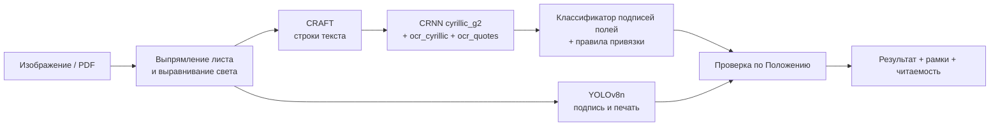
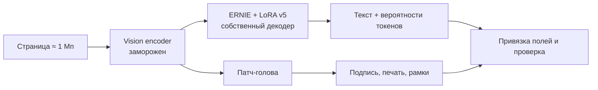

# Движки распознавания

Онлайн-деканат поставляется с двумя движками распознавания. У них общий контракт результата: тип документа, поля, проверка комплектности, статусы, уверенность и рамки. Поэтому приложение, API, ассистент и выгрузки работают одинаково с любым из них.

| | **Конвейер** | **Цельная модель** |
| --- | --- | --- |
| Принцип | Специализированные модели и детерминированные правила | Одна визуально-языковая модель читает страницу целиком |
| Оборудование | CPU, видеокарта не нужна | GPU с 8 ГБ памяти (RTX 3060 Ti и выше) |
| Время на страницу | **4,2 с** (Ryzen 5 3600, 6 потоков), около 6 с на фото с телефона | **3,5 с** (RTX 3060 Ti) |
| Поля, набор кейса PNG / PDF | **100% / 100%** | 99,6% / 99,3% |
| Поля, реалистичные фото бланков | **100 из 112** | 38 из 112 |
| Подпись и печать | YOLOv8n, дообученный | Патч-голова на признаках модели |
| Рамки полей | По строкам OCR, сразу с результатом | Задача `Spotting:` той же модели, в фоне |
| Типы из конструктора | Поддерживаются | Только встроенные типы |
| Живая камера | Быстрый режим, 2–3,5 с на кадр | — |
| Размер весов | ≈ 140 МБ | ≈ 1,9 ГБ + адаптер и головы |
| Флаг запуска | `--engine cpu` (по умолчанию) | `--engine gpu` |

## Конвейер (по умолчанию)



Конвейер раскладывает задачу на этапы. У каждого этапа своя небольшая модель или детерминированное правило. Поэтому он быстрый на CPU, предсказуемый и объяснимый: для каждого значения известна строка, из которой оно взято, и уверенность распознавателя. Новые типы документов добавляются без обучения, через [конструктор](app.md#конструктор-типов-документов).

Подробно: [Конвейер](pipeline.md), [Методы](methods.md).

## Цельная модель



PaddleOCR-VL 1.6 (0,9 млрд параметров) читает страницу за один визуальный проход. Языковая часть дообучена адаптером LoRA на русских документах. Подпись и печать определяет патч-голова на тех же визуальных признаках. Собственный декодер со статическим KV-кэшем и CUDA graph выдаёт тот же текст, что и стандартная генерация, побайтно, но в 4–6 раз быстрее.

Подробно: [Цельная модель](model.md).

## Как выбрать

- **Нет видеокарты, или важна предсказуемая скорость** — конвейер. Это режим публичной установки и режим по умолчанию.
- **Есть GPU, документы с произвольной вёрсткой, нужен полный текст страницы для ассистента** — цельная модель.
- **Сервер без GPU и компьютер с GPU** — сервер принимает документы, агент на компьютере выполняет распознавание. См. [Развёртывание](deployment.md).

Движок выбирается при запуске:

```bash
python -m scripts.app.server --engine cpu
```

```bash
python -m scripts.app.server --engine gpu
```

Для агента используется флаг `--engine cpu|gpu` в `scripts.app.agent`.
