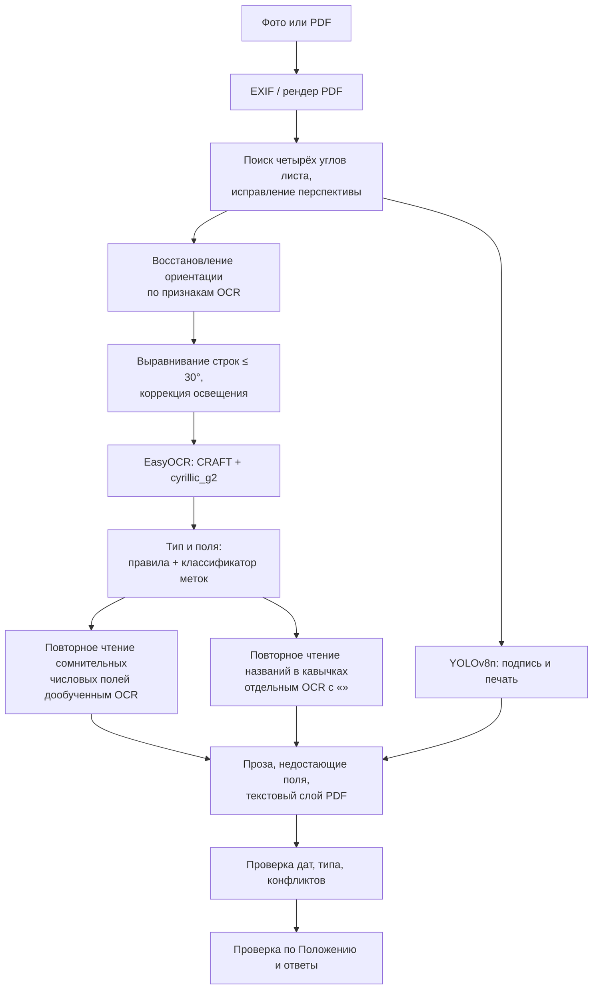

# Прежнее поколение: EasyOCR + YOLO + правила (web-v1)

До перехода на одну мультимодальную модель сервис состоял из нескольких специализированных моделей и правил. Это поколение работало на публичном сайте как релиз web-v1. Его код и веса сохранены в репозитории: они нужны для воспроизведения и для отката.

## Конвейер



| Этап | Модуль | Как устроен |
| --- | --- | --- |
| Предобработка | `dekanat/preprocessing.py`, `orientation.py` | Поиск углов яркого листа на тёмном фоне, гомография, выравнивание строк, коррекция освещения только для OCR. Поворот на 90°, 180° или 270° выбирается по качеству OCR. Матрица `rectified_to_input` сохраняет связь с исходником |
| OCR | `dekanat/ocr.py` | EasyOCR 1.7.2: детектор CRAFT и распознаватель `cyrillic_g2` |
| Дообученный OCR | `models/ocr_cyrillic.pt` | `cyrillic_g2` дообучен на 4000 синтетических фрагментах. CNN заморожен, обучались последовательные слои. Используется каскадом только для сомнительных числовых полей: путаница 0/О, 3/З, номера групп. Включение привязано к SHA весов (`ocr_selection.json`) |
| Кавычки | `models/ocr_quotes.pt` | Распознаватель с двумя добавленными токенами «». Перечитывает название вуза и организации, только если поле не найдено (`quote_selection.json`) |
| Поля | `dekanat/extraction.py`, `models/fields.joblib` | Правила по меткам и компактный классификатор меток (scikit-learn), обученный на 21 802 синтетических префиксах с имитацией ошибок OCR |
| Отметки | `models/marks.pt` | YOLOv8n, дообученный на 383 страницах: реальные подписи Ultralytics и синтетические печати. Слабые кандидаты, перекрывающие напечатанную надпись «Подпись», отклоняются (`mark_guard.py`) |
| Резервный классификатор | `models/visual.pt` | MobileNetV3 Small по нижней зоне страницы. Используется только если нет `marks.pt`, и всегда помечает результат «Проверьте» |
| Проза и слоты | `dekanat/narrative.py`, `slots.py` | Значения из типовых предложений («Настоящая справка выдана …») и недостающие поля с единственным кандидатом |
| PDF | `dekanat/pdf_text*.py` | Текстовый слой PDF дополняет только недостающие поля. Растровый OCR выполняется всегда |
| Даты | `dekanat/field_validation.py` | Нормализация разделителей, проверка календаря, неполные даты не достраиваются |

## Интерфейсы

- `app.py` — первый интерфейс на Streamlit, запуск через `launch.ps1`. Использует демонстрационные правила `configs/policy.demo.json`.
- `scripts/serve_api.py` + `web/` — HTTP API с очередью из одного worker и веб-интерфейс «liquid glass». Это релиз web-v1 на сервере: 4 CPU, 4 ГБ, nginx.
- `scripts/check_document.py` — проверка одного документа из командной строки:

  ```bash
  python scripts/check_document.py document.pdf --type study_certificate --question "Какова дата выдачи?" --output result.json
  ```

## Результаты

На документах организаторов (30 документов × PNG и PDF, 120 вопросов):

| Метрика | PNG | PDF |
| --- | --- | --- |
| Точные значения полей | 96,92% | 98,67% |
| Проверка комплектности | 100% | 100% |
| Ответы на вопросы | 100% | 100% |

Эти документы просматривались при разработке прежнего поколения, поэтому результат не является независимой оценкой.

## Почему произошла замена

- **Скорость.** Прежний конвейер последовательно запускал несколько моделей и повторные чтения. Одна модель на GPU читает страницу за 3,5 с.
- **Хрупкость.** Каждая новая вёрстка требовала новых правил, повторных чтений и порогов. Ошибки детектора, OCR и привязки складывались.
- **Вопросы.** Ответы по правилам покрывали ограниченный набор намерений. Ассистент понимает перефразировки и контекст диалога.
- **Качество.** Одна модель с адаптером v5 и патч-головой превосходит прежний конвейер на тех же документах организаторов (279/280 значений на PNG против 96,9%), находит подписи и печати на реалистичных бланках и даёт рамки.

## Эксперименты прежнего поколения

| Эксперимент | Итог |
| --- | --- |
| Полная замена распознавателя дообученным `cyrillic_g2` | Отклонена: целые карточки стали хуже. Оставлен каскад для числовых полей |
| Предобработка размытых снимков: unsharp, Otsu, adaptive threshold | Отклонена |
| Пороги отказа от отдельных полей (22 варианта) | Отклонены: потери верных значений дороже найденных ошибок |
| Рукописный OCR: дообучение на реальных строках, отдельная основа PARSeq | Не включён: недостаточно данных и переноса |
| Устойчивость к съёмке: 19 условий (ракурс, свет, смаз, вспышка) | Принята коррекция перспективы и освещения |

Код этих экспериментов: `scripts/evaluate_*.py`, `scripts/train_mixed_ocr.py`, `scripts/evaluate_parseq_pilot.py`, `scripts/stress_*.py`.
