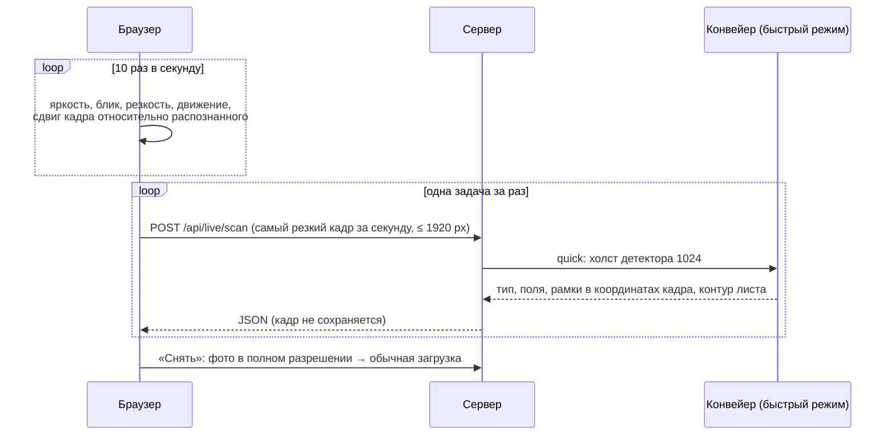

# Методы

Раздел описывает методы, на которых построена проверка документа: от подготовки изображения до проверки по Положению и живой камеры. Если не сказано иное, речь идёт о конвейере. Особенности цельной модели описаны в [model.md](model.md).

## 1. Подготовка изображения

**Выпрямление листа.** Страница ищется как самый крупный яркий четырёхугольник на более тёмном фоне. По четырём углам строится гомография, и лист приводится к прямоугольнику. Обратная матрица `rectified_to_input` сохраняется: по ней рамки с выпрямленной страницы переносятся обратно на исходное фото или кадр камеры.

**Освещение.** Фон оценивается сильным размытием и делится на него. Тени и неравномерный свет выравниваются. Коррекция применяется только к копии для распознавания: пользователю показывается исходная страница.

**Оценка качества.** Для страницы считаются разрешение, дисперсия лапласиана (резкость) и соотношение градиентов по осям (направленный смаз). Предупреждения передаются в результат.

## 2. Распознавание текста

**Детектор строк** CRAFT работает на холсте 1536 px. Распознаватель читает вырезки строк с полноразмерной страницы: уменьшается только холст детектора, но не сам текст.

**Каскад распознавателей.** Базовый распознаватель `cyrillic_g2` читает все строки. Два дообученных распознавателя применяются точечно:

| Распознаватель | Когда применяется | Что исправляет |
| --- | --- | --- |
| `ocr_cyrillic.pt` | Сомнительные цифровые поля: даты, номера, курс, коды групп | Путаница 0/О, 3/З, 1/l, пропуски разделителей |
| `ocr_quotes.pt` | Название вуза, организации и оценка не найдены | Названия в «ёлочках»: у базового распознавателя нет этих символов |

Каскад включается только для полей, где он улучшает результат, — это зафиксировано в `models/ocr_selection.json` и `quote_selection.json` вместе с SHA-256 весов.

## 3. Тип документа

Тип определяется по заголовку и характерным фразам распознанного текста: «справка об обучении», «академический отпуск», «справка о прохождении практики». Для типов из конструктора используются фразы администратора, сравнение идёт по основам слов в верхней половине страницы. Если документ уже узнан как встроенный тип, пользовательский тип может перехватить его только фразой из двух и более слов.

Тип можно выбрать вручную. Тогда поля другого типа не подставляются: если заголовок не совпадает, поля остаются пустыми, а пользователь видит подсказку.

## 4. Привязка полей

Значение поля — это текст рядом с его подписью на бланке.

1. **Подписи полей.** Классификатор `fields.joblib` (TF-IDF по символьным 2–5-граммам и логистическая регрессия) определяет, какое поле подписано в строке. Он устойчив к ошибкам OCR: обучен на префиксах с имитацией типичных искажений.
2. **Значение** берётся справа от подписи до конца строки или строкой ниже, если справа пусто.
3. **Проза.** Типовые предложения («Настоящая справка выдана … в том, что … является студентом …») разбираются ограниченными шаблонами.
4. **Запасные правила.** Срабатывают, только если поле ещё пустое:
   - период «с … по …» — первые две возрастающие даты после слова «отпуск», «практика» или «обучение»;
   - причина отпуска — по типовой формулировке.
5. **Конфликт.** Если одна подпись встречается с разными значениями, поле получает статус `conflict` и пометку «Проверьте».

Значения не дополняются и не угадываются: неполная дата не достраивается, отсутствующее поле остаётся «не найдено».

## 5. Нормализация

| Правило | Пример |
| --- | --- |
| Латинские буквы-двойники внутри русских слов | «c уходом» → «с уходом» |
| Ноль в буквенном префиксе номера | «0Б-1003» → «ОБ-1003» |
| Символ вместо единицы в коде группы | «ИВТ-2]» → «ИВТ-21» |
| Кавычки, прочитанные как буквы | `кПарус>` → «Парус» |
| Подпись поля в значении руководителя | «от организации: Иванов И. И.» → «Иванов И. И.» |
| Даты | «05.03.2026», «5 марта 2026 года» → `2026-03-05` |

## 6. Проверка по Положению

Обязательные поля каждого типа и пункты Положения заданы в `configs/participant_v1.json`. Проверка возвращает:

- статус `document_ok` или `missing_fields`;
- список недостающих полей;
- источники — пункты Положения.

Для студента недостающие поля превращаются в обычный текст с родительным падежом и номерами пунктов (`workflow.submit_warning`).

## 7. Уверенность и «Проверьте»

Уверенность значения — минимальная уверенность распознавателя по строкам, из которых оно собрано. Ниже 0,5 значение помечается «Проверьте». Пометка показывает, где нужен взгляд человека, но значение не скрывает.

## 8. Подпись и печать

Детектор YOLOv8n ищет на выпрямленной странице два класса: подпись и печать. Кандидат с низкой оценкой, который перекрывает напечатанное слово «Подпись», отклоняется. Для типов из конструктора отклоняется кандидат, лежащий на уверенно распознанной строке текста: так жирный заголовок не принимается за подпись.

**Место недостающей отметки.** Если отметки нет, в тексте ищется напечатанное место для неё: «(подпись)», «подпись студента / руководителя», «М.П.», «место печати». Рамка этого места возвращается с `kind: "missing"` и подсвечивается красным на странице и в живой камере.

## 9. Читаемость снимка

Для строк длиной от 4 символов считаются средняя уверенность распознавателя и доля строк с уверенностью ниже 0,4. Снимок считается читаемым, если средняя уверенность не ниже 0,5 и неуверенных строк не больше 40%. Пороги выбраны на снимках и сканах: у пригодных снимков 0,68–0,88 и не больше 10% неуверенных строк, у снимка экрана монитора 0,31 и 74%. Нечитаемый снимок получает предупреждение на странице документа и в тексте перед отправкой.

## 10. Сверка ФИО

ФИО из документа сравнивается с ФИО в профиле студента. Сравниваются фамилия и имя по основам из трёх первых букв, в любом порядке. Поэтому «Козловой Анны» совпадает с «Козлова Анна». При несовпадении студент и сотрудник видят красную отметку.

## 11. Типы из конструктора

Конфигурация типа хранит:

- название;
- фразы заголовка;
- поля: подпись и её варианты, вид значения (`text`, `name`, `date`, `number`), обязательность;
- требования к подписи и печати;
- пункт Положения.

Движок находит подпись поля в строке с допуском к регистру, «ё/е» и латинским двойникам. Значение приводится к виду поля:

- дата — ISO;
- ФИО — 2–3 слова с заглавной буквы или фамилия с инициалами;
- номер — первая группа символов с цифрой.

Конфигурации передаются движку с каждой задачей, поэтому одинаково работают локально и через агента.

## 12. Живая камера

- **Качество в браузере.** По уменьшенному кадру считаются:
  - средняя яркость;
  - доля пересвеченных пикселей на неравномерно белом листе (блик);
  - дисперсия лапласиана (резкость);
  - сглаженная разность соседних кадров (движение).
- **Дрожание рук.** Сдвиг текущего кадра относительно распознанного оценивается сопоставлением блоков в окне ±8 пикселей миниатюры. Рамки смещаются вместе с изображением. Если сцена сменилась, рамки скрываются.
- **Снимок.** `ImageCapture.takePhoto()` даёт фото с сенсора в полном разрешении. Если API недоступен, используется кадр видеопотока в максимальном разрешении. Кнопка «Фото камерой телефона» открывает системное приложение камеры.
- **Подсказки сервера.** Ответ содержит долю листа в кадре и признак читаемости. По ним показываются «поднесите ближе» и «текст читается плохо».
