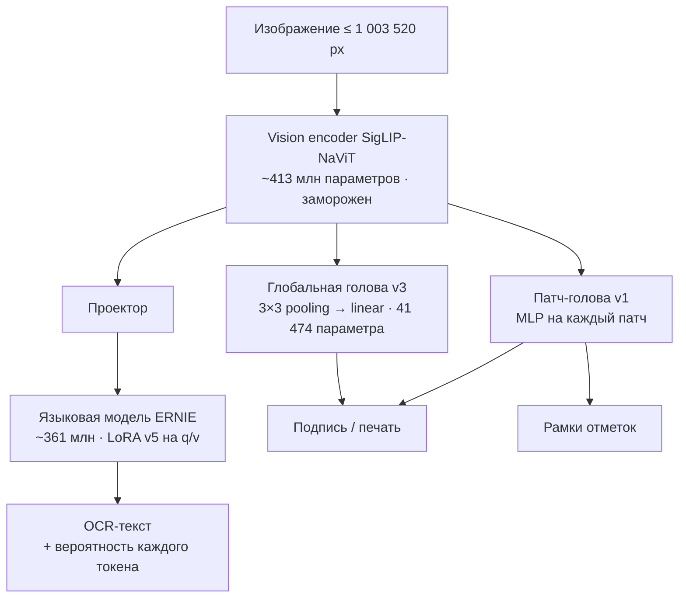

# Модель

Весь документ читает **одна** нейросеть — PaddleOCR-VL 1.6. Подпись и печать определяют две небольшие головы на её же визуальных признаках. Второго OCR, детектора или отдельного энкодера нет. Один визуальный проход на страницу проверяется в коде: если энкодер вызван не ровно один раз, чтение завершается ошибкой.



## Базовая модель

| | |
| --- | --- |
| Модель | [PaddlePaddle/PaddleOCR-VL-1.6](https://huggingface.co/PaddlePaddle/PaddleOCR-VL-1.6), ревизия `c5630abae1d940eafe0697512a0325494b02ab42` |
| Параметры | 905 601 648 |
| Лицензия | Apache-2.0 |
| Загрузка | Transformers 5.5.4, `trust_remote_code=False`. Удалённый код не выполняется, полный конвейер Paddle не нужен |
| Точность | Строгий FP32, TF32 выключен для matmul и cuDNN |
| Разрешение | `longest_edge = 1 003 520` пикселей (~1 Мп) |
| Задачи | `OCR:` — текст страницы, `Spotting:` — строки с координатами |
| Бюджет | 1024 новых токена на страницу. Если он исчерпан, документ помечается, а пустые поля не заполняются догадками |

Почему строгий FP32:

- результат воспроизводим между устройствами: CPU и GPU дают тот же текст, поля и отметки, расхождение оценок до 6·10⁻⁵;
- BF16 не ускорял декодирование, потому что оно упирается в накладные расходы на каждый шаг, а не в арифметику.

Скачать веса: `python deploy/app-v2/fetch_base_model.py deploy/app-v2/base-model-manifest.json work/paddle-vl-base-v1`. Скрипт проверяет SHA-256 каждого файла.

## Адаптер LoRA v5 (`models/unified-experimental-natural-v5`)

Дообучается только языковая часть. Vision encoder и графические головы заморожены. После обучения хэши всех 437 параметров vision совпадают, а признаки и оценки голов на контрольных изображениях совпадают бит в бит.

| Параметр | Значение |
| --- | --- |
| Модули | `q_proj`, `v_proj` языковой модели |
| Ранг / α / dropout | 8 / 16 / 0,05 |
| Обучаемых параметров | 626 688 |
| Инициализация | Адаптер v4 (`unified-experimental-literal-values-fp32-v4`) |
| Данные | 360 страниц v5 (естественный текст, 27 семейств шрифтов, разные подписи полей) и 120 страниц v4b для повторения |
| Шаги | 240 (480 микробатчей, накопление 2), один проход |
| Оптимизатор | AdamW, LR 2·10⁻⁵, разогрев 16 шагов, косинус до 0,1×, weight decay 0,01, clip 1,0, seed 42 |
| Время | 1680 с на RTX 3060 Ti, пик памяти 5,7 ГБ |
| SHA-256 | `37ca4920…1317` |

Как получены данные и что показала оценка: [training.md](training.md), [evaluation.md](evaluation.md).

## Глобальная графическая голова v3

Признаки всех патчей сводятся в сетку 3×3 (mean и max), всего 20 736 чисел. По ним одна линейная проекция даёт две оценки: «есть подпись» и «есть печать».

- 41 474 параметра;
- обучена в FP32 на 383 страницах;
- оценки не откалиброваны как вероятности.

## Патч-голова v1 (`models/unified-experimental-mark-patches-v1`)

Глобальная голова не даёт координат. Она пропускала подписи поверх линии и иногда «видела» печать там, где её нет. Патч-голова оценивает каждый патч отдельно.

```text
вход патча  = [признак патча (1152), среднее соседей 3×3 (1152)]   → 2304
MLP         = Linear(2304 → 128) → GELU → Linear(128 → 2)          → подпись, печать
карта       = sigmoid → сглаживание 3×3
наличие     = max(карта) ≥ 0,94
рамка       = связная область вокруг максимума, где p > max(0,4; 0,6·max)
```

| Обучение | |
| --- | --- |
| Страницы | 743 train: 360 новых `marks-v1`, `unified-data-v2` и `unified-real-marks-v1` |
| Сэмплинг | Все положительные патчи и до 700 отрицательных с каждой страницы |
| Потеря | BCE с `pos_weight` = доля отрицательных (не больше 30) |
| Оптимизатор | AdamW, LR 2·10⁻³, weight decay 0,01, 3000 шагов по 4096 патчей, seed 42 |
| Выбор порога | Только на val: перебор порога 0,20–0,94 и правила «решает патч-голова» или «любая из голов». Выбрано 0,94 и «решает патч-голова» |

Набор `marks-v1` создан специально под ошибки старой головы. В нём есть:

- подпись поверх линии над «(подпись)»;
- круглые и прямоугольные печати;
- негативы: пустые строки подписи, «М.П.» без печати, цветные логотипы.

Генератор: `scripts/unified/prepare_mark_pages.py`.

## Граф-декодер (`scripts/unified/fast_decode.py`)

Профилирование показало, что около 50 мс на токен уходило на Python и запуск ядер. Кроме того, FP32-ядро внимания плохо работает с одним запросом. Граф-декодер оставляет ту же жадную стратегию и ту же точность:

1. **Prefill** выполняется обычным образом в `StaticCache`.
2. **Шаг декодирования** записывается один раз как CUDA graph и затем воспроизводится.
3. **Внимание** групповое (GQA), прямо по кэшу, без копий `repeat_kv`. Оно зарегистрировано через `AttentionInterface` и `AttentionMaskInterface`.
4. **Вероятность выбранного токена** (максимум softmax) сохраняется для оценки уверенности.

При любой ошибке включается обычный `generate`.

| Квалификация (`scripts/unified/qualify_fast_decode.py`) | Результат |
| --- | --- |
| OCR-текст на 156 страницах (60 организаторов, 96 v4b) против сохранённых выходов `generate` | **156/156 побайтно** |
| Поля и отметки на документах организаторов | 60/60 совпали, разница оценок 0,0 |
| Время на страницу | 3,5 с в среднем (2,7–4,6 с) против 15–22 с; из них vision около 1,7 с |
| Декодирование | 57 → 14,5 мс на токен |

## Привязка полей

Значения ищутся в прочитанном тексте детерминированно (`scripts/unified/text_binding.py`):

- **Подписи полей.** Ищутся явные подписи схемы: «ФИО студента:», «Номер справки:», «Дата начала практики:» и их варианты. Значение — текст после подписи до конца логической строки.
- **Layout v1.** Если модель склеила две соседние пустые метки, они разделяются (`separate_empty_labels`).
- **Layout v2.** Перед следующей полной меткой схемы пробел заменяется переводом строки (`separate_label_runs`). Длина текста и все непробельные символы при этом сохраняются.
- **Проза.** Сведения справки об обучении, записанные одним предложением, восстанавливаются ограниченными шаблонами (`prose_binding.py`). Заполняются только пустые поля.
- **Даты.** Приводятся к ISO, если записаны полностью. Неполная дата не достраивается.
- **Конфликт.** Если одна метка встречается с разными значениями, поле получает статус `conflict` и пометку «Проверьте».

Тип документа определяется по заголовку в прочитанном тексте. Если выбранный вручную тип не совпадает с заголовком, текстовые поля остаются пустыми. Подставлять значения из «чужой» схемы нельзя.

## Уверенность и «Проверьте»

Для каждого найденного значения берётся минимум вероятностей его токенов. Токены подписи поля не учитываются.

| Поле | Порог |
| --- | --- |
| `student_name`, `supervisor_name` | 0,8 |
| остальные текстовые | 0,4 |

Порог выбран на v4b val/test, где известны правильные значения, и проверен на документах организаторов (`scripts/app/calibrate_review.py`):

| | Найдено ошибочных значений | Лишних пометок на верных |
| --- | --- | --- |
| v4b val/test | 8 из 10 | 63 из 570 (11%) |
| Документы организаторов | 3 из 3 | 48 из 407 (12%) |

«Проверьте вручную» у подписи или печати появляется, если в тексте есть место для отметки («(подпись)», «М.П.»), а отметка не найдена.

## Разметка полей

Задача `Spotting:` той же модели возвращает строки с четырёхугольниками. `field_regions.py` сопоставляет значения полей со строками и строит рамки. Рамки подписи и печати даёт патч-голова. Разметка выполняется в фоне после распознавания и уступает очередь новым загрузкам.
