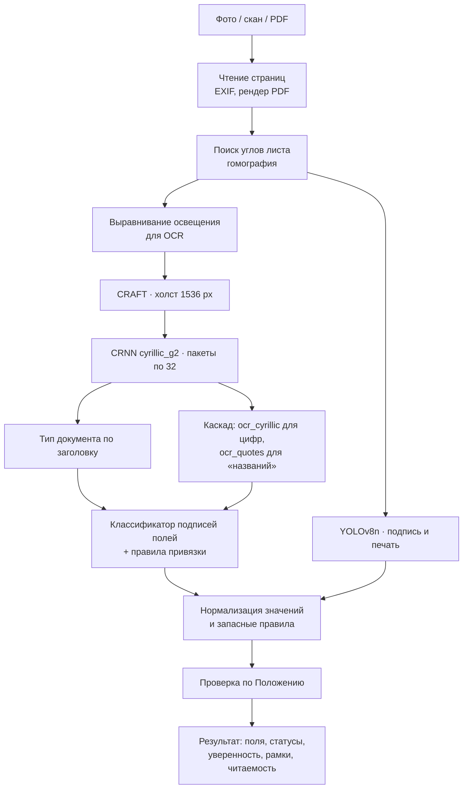

# Конвейер

Конвейер — CPU-движок распознавания по умолчанию. Процесс-читатель `scripts/app/fast_worker.py` загружает все модели один раз, прогревается на образце и затем обрабатывает задачи по одной: один JSON на строку stdin, ответ — одна строка stdout.



## Этапы

| Этап | Модуль | Устройство |
| --- | --- | --- |
| Чтение файла | `dekanat/io.py` | PNG, JPG (с учётом EXIF-поворота) и PDF (рендер страниц) |
| Выпрямление | `dekanat/preprocessing.py` | Поиск четырёх углов яркого листа на контрастном фоне, гомография. Матрица `rectified_to_input` связывает выпрямленную страницу с исходным кадром |
| Освещение | `dekanat/preprocessing.py` | Деление на оценку фона. Применяется только для OCR, а не к сохраняемому изображению |
| Строки | EasyOCR CRAFT | Холст детектора 1536 px — выбран на наборе кейса: 1024 теряет даты, 2000 медленнее без выигрыша |
| Распознавание | EasyOCR CRNN `cyrillic_g2` | Строки читаются с полноразмерной страницы, пакетами по 32 |
| Каскад цифр | `models/ocr_cyrillic.pt` | Перечитывает сомнительные цифровые поля: путаница 0/О, 3/З, коды групп, даты |
| Каскад кавычек | `models/ocr_quotes.pt` | Распознаватель с токенами «». Перечитывает название вуза, организации и оценку, если поле не найдено |
| Тип документа | `dekanat/extraction.py` | По заголовку и характерным фразам. Типы из конструктора — по фразам администратора |
| Поля | `dekanat/extraction.py`, `models/fields.joblib` | Классификатор узнаёт подписи полей, правила берут значение справа или строкой ниже |
| Проза | `dekanat/narrative.py`, `slots.py` | Значения из типовых предложений («Настоящая справка выдана …») |
| Подпись и печать | `models/marks.pt` | YOLOv8n. Слабые кандидаты поверх печатной надписи «Подпись» отклоняются |
| Нормализация | `scripts/app/fast_worker.py` | Кавычки, латинские буквы-двойники, «0» в буквенном префиксе номера, «]» вместо «1» в коде группы |
| Запасные правила | `scripts/app/fast_worker.py` | Период «с … по …», прочитанный в другом порядке, причина отпуска. Заполняют только пустые поля |
| Проверка | `scripts/participantkit/format_v1.py` | Обязательные поля и пункты Положения из `configs/participant_v1.json` |
| Места отметок | `scripts/app/fast_worker.py` | Если подписи или печати нет, ищется напечатанное «(подпись)» или «М.П.», и возвращается рамка этого места |
| Читаемость | `scripts/app/fast_worker.py` | Средняя уверенность распознавателя и доля неуверенных строк |

## Производительность

| Условия | Время на страницу |
| --- | --- |
| Ryzen 5 3600, 6 потоков, документы кейса PNG | 4,2 с в среднем, максимум 4,6 с |
| То же, PDF | 4,4 с в среднем |
| Фото реалистичного бланка | около 6 с |
| Кадр живой камеры, быстрый режим (холст 1024) | 2–3,5 с |
| Сервер Xeon 2,2 ГГц, 5 потоков | около 14 с |

Вычисления выполняются в FP32, без квантования. Детектор работает в формате памяти `channels_last`: на CPU это примерно на 20% быстрее при тех же результатах. Поиск ориентации на 90°/180° по умолчанию выключен (`DEKANAT_ORIENTATION=0`).

## Параметры окружения

| Переменная | По умолчанию | Назначение |
| --- | --- | --- |
| `DEKANAT_DETECT_SIDE` | `1536` | Размер холста детектора строк |
| `DEKANAT_OCR_BATCH` | `32` | Размер пакета распознавателя |
| `DEKANAT_THREADS` | `6` | Потоки PyTorch |
| `DEKANAT_ORIENTATION` | `0` | Поиск поворота страницы |
| `DEKANAT_CPU_PYTHON` | `work/venv` | Интерпретатор окружения конвейера |

## Протокол процесса-читателя

Запрос:

```json
{"task": "ocr", "input": "…/input.jpg", "output": "…/native-result.json",
 "document_type": "auto", "quick": false, "custom_types": []}
```

Ответ: `{"ok": true}`, результат записывается в `output`. Ключевые поля строки результата:

| Поле | Содержание |
| --- | --- |
| `detected_type` | Официальный ключ типа или ключ типа из конструктора |
| `fields`, `validation` | Значения в формате кейса и проверка комплектности |
| `statuses`, `confidence` | `found` / `not_found` / `conflict` и уверенность по каждому полю |
| `regions` | Нормализованные рамки полей; `kind: "missing"` — место недостающей отметки |
| `quality` | `mean_confidence`, `low_share`, `readable`, `warnings` |
| `live` | Только в быстром режиме: рамки в координатах кадра, контур листа, доля листа в кадре |
| `ocr_text` | Распознанный текст в порядке чтения |
