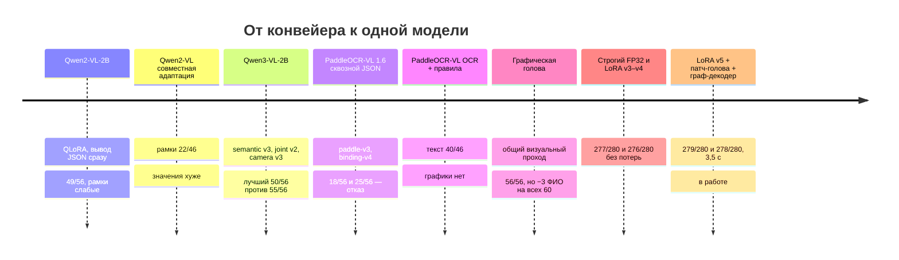

# Журнал экспериментов: цельная модель

Журнал описывает разработку второго движка — **цельной модели**, которая читает текст и находит подпись и печать за один проход (см. [Движки распознавания](engines.md)). Ниже перечислены все этапы, включая отклонённые. Веса всех экспериментов лежат в [`models/`](../models/README.md).

Действовало одно правило: кандидат заменяет рабочую версию, только если на тех же документах **не теряет ни одного ранее верного значения**. Средний выигрыш при потерях не принимался.

## 1. Сквозная модель: изображение → JSON

**Идея.** Модель сразу выдаёт JSON с типом, полями, отметками и рамками (`scripts/unified/contract.py`).

| Этап | Основа | Что сделано | Итог |
| --- | --- | --- | --- |
| Пилот | Qwen2-VL-2B-Instruct | QLoRA (NF4/BF16), 120 шагов на 72 вымышленных документах | 49/56 значений на 6 контрольных документах; рамки почти не попадают. Отклонён |
| Совместные адаптеры | Qwen2-VL-2B | LoRA на vision и language | Рамки 2 → 22/46, значения 48/56. При 2 Мп значения хуже (41/56). На новых контролях 42/56 против 53/56 у рабочего конвейера |
| Expanded v2 | Qwen2-VL-2B | Больше макетов и абзацев, продолжение весов | Отклонён: потери верных значений |
| Semantic v3 | Qwen2-VL-2B | Балансировка loss по ключам | Отклонён |
| Qwen3 v1 / joint v2 | Qwen3-VL-2B-Instruct | Языковой и совместный адаптеры | Лучший пригодный профиль 50/56 против 55/56. Геометрия некорректна |
| Camera v3 | Qwen3-VL-2B | +100 шагов на 144 «снимках камерой» | 54/56 на снимках против 43/56, но 50/56 на документах организаторов. Отклонён |

Сравнение точности вычислений (NF4, BF16, разные разрешения) показало, что выигрыш одного профиля на одном наборе не переносится на другой.

**Вывод.** Модель на 2 млрд параметров, которая сразу пишет JSON, путает значения похожих полей и не даёт надёжной геометрии. Ошибки чтения и привязки при этом не разделить.

## 2. Компактная специализированная основа: PaddleOCR-VL 1.6

PaddleOCR-VL — 0,9 млрд параметров, обучена именно на документах. На 8 контрольных страницах её чтение текста дало CER 1,98% против 6,92% у OCR-этапа прежнего конвейера.

| Этап | Что сделано | Итог |
| --- | --- | --- |
| Сквозной пилот (`paddle-v3`) | Совместная LoRA, 160 шагов, 420 страниц, JSON на выходе | 18/56 против 45/56. Отклонён |
| Binding-loss v4 | +300 шагов, веса loss типа и ключей 8/4 | 25/56, на документах организаторов 8/56. Отклонён |
| **Родной OCR + детерминированная привязка** | Модель только читает текст (`OCR:`), поля находят правила по подписям | 40/46 текстовых значений против 45/46. Выдуманных значений нет. Путь выбран |

**Вывод.** Пусть модель делает то, чему её учили, — читает. Поля находит прозрачная привязка, которую легко проверять и исправлять.

## 3. Подпись и печать на том же визуальном проходе

| Этап | Что сделано | Итог |
| --- | --- | --- |
| Проба вопросами | Спросить модель о подписи текстом | 0/6 пригодных ответов. Отклонено |
| Графическая голова v1 | Линейный выход (41 474 параметра) на замороженных признаках, 120 страниц | 50/56: пропуск 6 подписей |
| Голова v2 | +143 страницы с реальными подписями, +120 «снимков камерой» | 56/56 на шести документах; на всех 60 — 277/280, но потеряны 3 ФИО относительно конвейера |
| Голова v3 | Та же голова в строгом FP32 | Отметки 50/50 на PNG и PDF |
| **Патч-голова v1** | MLP на каждый патч, рамка вокруг максимума, 743 страницы | Ошибки на реалистичных бланках 4/5 → 0/0, на `marks-v1` test 22/26 → 0/1. Используется |

Код проверяет, что визуальный энкодер вызывается ровно один раз на страницу и что токены OCR совпадают с чтением без голов.

## 4. Точность вычислений и чтение текста

| Этап | Что сделано | Итог |
| --- | --- | --- |
| LoRA v1 | Языковой адаптер на 120 изображениях | Test 29 → 31/33, но потеряно 1 верное значение. Отклонён |
| Fullpage v2 | Полные страницы при 2 Мп, BF16 | Само по себе 2 Мп ухудшает OCR. Отклонён |
| Переход на строгий FP32 | Явно выключен TF32; сравнение CPU и GPU | Расхождение признаков CPU/GPU 0,001 против 1,9 у BF16. Результат воспроизводим |
| LoRA v3 | FP32, 1 Мп, 64 страницы | Без потерь; CER на новых страницах 70 → 44 правки |
| LoRA v4 | 192 страницы со значениями всех трёх схем | Документы организаторов 277/280 и 276/280 без потерь; +2 новых верных ФИО на test |
| **LoRA v5** | Естественные страницы: Википедия, реальные фамилии, 27 шрифтов, дефекты скана | 279/280 и 278/280, без потерь. Используется |

Найденные по пути регрессии и как они закрыты — в [evaluation.md](evaluation.md#ocr-lora-v4--v5).

## 5. Скорость

Профилирование показало, что около 50 мс на токен уходит на Python и запуск ядер. BF16 этого не меняет. Граф-декодер (`fast_decode.py`) записывает шаг декодирования в CUDA graph и считает внимание прямо по статическому кэшу:

- 57 → 14,5 мс на токен;
- 15–22 → 3,5 с на страницу;
- 156/156 страниц побайтно совпадают с `generate`.

## 6. Ассистент

| Кандидат | Верных реплик |
| --- | --- |
| **qwen3.5:4b** | 97,0% |
| gemma4:e4b | 94,0% |
| gemma4:e2b | 89,6% |
| qwen3.5:2b | 86,6% |
| gemma3:4b | 72,4% |

Шесть версий промпта, проверка привязки, перегенерация, запасной движок правил. Дообучение не понадобилось. Подробности — [assistant.md](assistant.md).

## Открытые вопросы

- **Свободная вёрстка.** Если на документе нет стандартных подписей полей, карточка заполняется плохо. Нужна гибкая привязка по распознанному тексту с той же проверкой.
- **Порядок блоков** на многоблочных страницах: в обучение нужны страницы с боковыми блоками и метрика, которая отдельно учитывает порядок.
- **Многостраничные PDF.**
- **Рукописные поля.**
